# Cere

[Download Cere Mobile 0.1.3 for Android](https://github.com/otectus/Cere/releases/download/mobile-dev-v0.1.3/cere-mobile-v0.1.3-debug.apk) · [Development release and checksums](https://github.com/otectus/Cere/releases/tag/mobile-dev-v0.1.3)

This development APK updates the existing Cere Mobile debug app in place. It includes approval synchronization fixes; removing desktop rate limits also requires the matching broker source from this repository. Android 11 or newer is required. See [mobile setup](docs/mobile/SETUP.md) for pairing.

Workspace telemetry is available as an opt-in Linux feature under Settings.
See [setup, privacy boundaries, shell hooks and measurements](docs/workspace-telemetry.md).

A native desktop companion for Arch Linux and Hyprland. Click Cere for chat and desktop controls; drag her to move. Cere, Daemona, Jade, Nova and Soap use their front-view reference artwork, connected full-body gesture frames and registered eyelids. Reduced motion preserves each original still pose. Always-on-top is enabled initially, including above fullscreen application windows. Disable it for normal floating-window behavior.

<p align="center">
  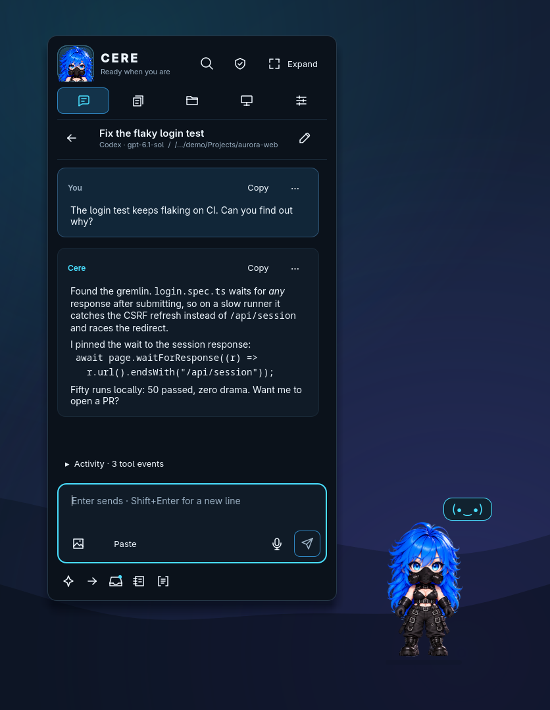
  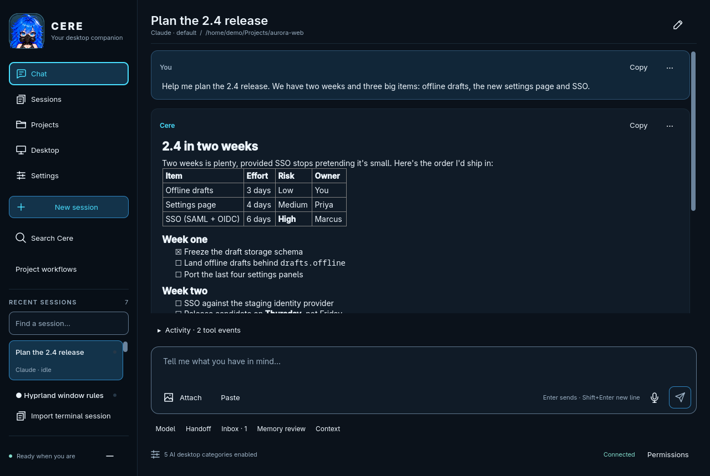
</p>

The compact panel beside Cere, and the expanded workspace. See the [screenshot gallery](screenshots/README.md) for more; the conversations in it are scripted demo content.

## Run from this workspace

```sh
./tools/run.sh
```

Use `./tools/run.sh --show` to open the expanded workspace immediately. The tray opens or hides Cere and offers separate quit options for stopping sessions or leaving them running. Only one interface instance runs per runtime directory.

Build the application first using the instructions below. Generated binaries, local dependency bundles, user state, and credentials are not included in the repository. If `.local-deps` is present locally, `tools/run.sh` configures its library paths.

## Build and install on Arch

Local speech uses bundled Piper and `en_US-amy-medium`. Install Python 3.12+,
`alsa-utils`, `sox` and `pipewire-alsa` (or PulseAudio's ALSA plugin) alongside the build
dependencies below. The first build downloads checksum-pinned speech assets;
installed playback is offline. See [voice settings, `/tts-test`, custom voices and
Speech Dispatcher setup](docs/tts.md).

Voice settings also offer **ElevenLabs · API**, with a private API key, account
voice/model selection and streamed playback. **Speak replies from** lets you
enable automatic speech separately for each conversation provider, including
pinned conversations. See [voice and API setup](docs/tts.md#elevenlabs-api-speech).

**Settings → Voice → Speech provider → IndexTTS** adds optional local voice cloning,
multilingual IndexTTS-2.5 and an optional IndexTTS-2 checkpoint. Its pinned Python,
Torch and model files live in an isolated per-user runtime. Review the license
before downloading; allow about 30 GiB for setup. See the [IndexTTS installation,
voices, hardware limits and troubleshooting](docs/tts.md#indextts-voice-cloning).

Install `base-devel cmake ninja qt6-base qt6-declarative layer-shell-qt nodejs npm`. Desktop controls additionally use `hyprland gtk3 xdg-utils wireplumber libnotify grim satty systemd`. Qt 6.8 or newer is required for the avatar renderer. Node 26.8.2 is the validated runtime (see `.node-version`). Graph memory additionally requires Node’s linked SQLite to be 3.51.3 or newer with FTS5; startup rejects an older SQLite build. Install and authenticate Codex CLI and Claude Code separately; Cere uses those installed executables and their own authentication/configuration.

```sh
npm ci
npm run build
npm test
npm run typecheck
makepkg -si
```

The package installs `cere`, its desktop entry, and `cere-broker.service`. The installed UI starts the user service on demand, and starts it again if the broker stops while Cere is open. Login startup is opt-in in **Settings → Companion**. It adds an XDG autostart entry, which Hyprland runs only when the session processes autostart entries, for example through UWSM or `dex -a`. Removing the package preserves user data.

For a per-user installation after building, run `python3 tools/install-user.py`. This installs the application, menu entry, icon and user service beneath `~/.local`, and preserves an existing login-startup preference. When local build dependencies were used, it bundles LayerShellQt; base Qt and Node remain system dependencies. No project-folder launcher is needed. Use `--prefix build/user-install` to stage and inspect the installation first. Open **Cere** from your application menu, or run `~/.local/bin/cere --show`.

After installation:

```sh
cere                 # show the pet
cere show            # open the full workspace
cere toggle          # toggle the compact panel, starting Cere if needed and recovering a hidden pet
cere terminal codex  # register a terminal session, then run the normal CLI
cere terminal claude
```

Use your compositor’s configuration interface to bind `cere toggle` to a convenient shortcut. Cere does not replace your existing keybindings. The legacy Hyprland configuration equivalent is `bind = SUPER, C, exec, cere toggle`; newer Lua-based configurations use their own binding syntax.

## Interaction

- Click Cere to open her compact panel; the message box is ready for typing as soon as it opens. Dragging suppresses the click. Right-click for size, roaming, quiet mode, and visibility. With always-on-top disabled, the compact panel is a normal window that Hyprland floats beside her at its compact size.
- On short screens the compact panel folds **Model**, **Handoff**, **Inbox**, **Memory review** and **Context** into a **More** menu beside Send, and the conversation page scrolls rather than hiding controls, so every part of the panel stays reachable.
- Chat supports streaming replies, selectable CommonMark/GitHub Markdown (headings, emphasis, nested lists, task lists, tables, links, images and fenced/indented code), image attachments, Stop, and provider approvals. Tool activity stays in the expandable **Activity Panel** below the conversation; click its bar again to hide it. Enter sends (Ctrl+Enter works too) and Shift+Enter starts a new line; Ctrl+N creates a session; Ctrl+K opens the command palette; Ctrl+, opens Settings; Escape closes the panel.
- Codex and Claude questions appear as dedicated forms with option descriptions, single or multiple selections, and written answers. Required answers are checked before submission. Desktop question drafts survive navigation and unrelated progress updates in the same UI process; private answers are masked and redacted from Cere's conversation history. Permission bypass never supplies an answer.
- **Activity** shows native subagents and delegated conversations, including their current task, progress, result, and interruption or failure. Active agent counts remain visible when the panel is closed. Parent conversations stay busy while tracked background work remains, and child replies stay in Activity. Claude Code's reply after its background work finishes belongs to the same turn. Stop includes active child work.
- Expand opens an ordinary resizable workspace. Selecting a session restores its draft. Moving between the compact panel and the workspace keeps the draft and its attachments, the cursor and selection, the **Search web** choice, the Activity Panel and the message you were reading, even though the two windows lay the conversation out at different widths. New output does not force scrolling while you read earlier messages, whether you scroll with the wheel, by dragging, or with the scrollbar.
- New sessions offer Codex, Claude Code, Ollama, AntiGravity, OpenAI API, Claude API and Google AI API (see [AntiGravity and direct APIs](#antigravity-and-direct-apis)). CLI model and effort dropdowns use each provider’s catalog; their default choices retain the CLI’s settings. Ollama offers its available chat models and a saved default. Tick **Save as my defaults** as you open a conversation and the next one you start from **New session** opens with the same provider, model, effort, desktop tools and temporary choice. Titles, folders and trust are chosen each time; projects keep their own defaults, and delegated, branched, imported and phone-started conversations never use these.
- When both Cere windows are closed or minimized, pending permissions appear in a speech bubble beside the visible pet, with the same response buttons and session labels as the workspace. Every request names its provider and session ID, the full session title and the project folder on separate lines, so a long title never hides which project is asking. The bubble remains available in quiet mode and disappears when requests end or a Cere window opens.
- Sessions creates managed conversations or imports completed CLI history. Confirm that the external session is stopped before resuming it. The terminal launcher only reports lifecycle and offers terminal navigation; it does not scrape or remotely type into the terminal.
- Handoff lets you choose another provider and creates an editable draft using recent conversation text. Nothing is sent until you review and submit it.
- Desktop groups controls into responsive cards, with category filters and search across actions, applications, and windows. It launches applications, opens files/folders, focuses or moves windows, changes workspaces, controls media and live output volume, opens captures in Satty, creates timers, and runs saved executables with explicit arguments. Long names have tooltips; every section remains reachable by scrolling in the compact panel.
- Capture in Satty opens the focused display in the crop/annotation editor. Enter saves the edited image and returns to Cere’s preview; Escape cancels. The temporary original is removed. An explicit sharing choice precedes giving an AI session the saved image.
- Media controls prefer Spotify when it is open, otherwise the playing MPRIS application. Cere displays the target and playback state, pins button commands to that target, and disables unavailable actions. Closing the target does not silently redirect an in-flight button press to a browser.

<table>
<tr>
<td width="50%" valign="top">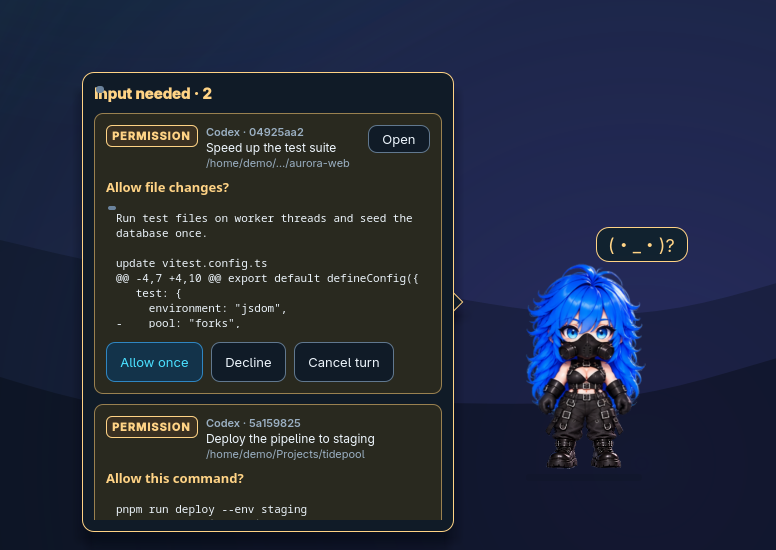<br>Pending approvals wait beside Cere while her windows are closed.</td>
<td width="50%" valign="top">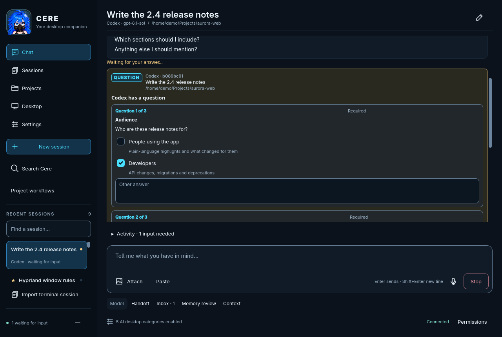<br>A Codex question form with option descriptions.</td>
</tr>
<tr>
<td width="50%" valign="top">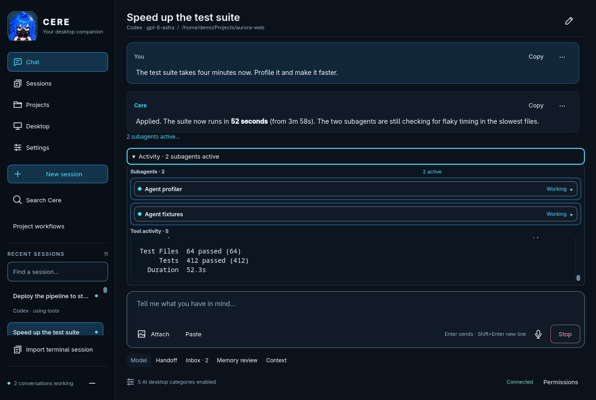<br>Activity keeps subagents and tool output below the conversation.</td>
<td width="50%" valign="top">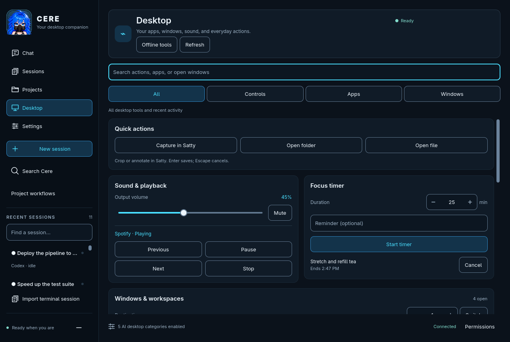<br>Desktop controls: quick actions, volume, media playback and timers.</td>
</tr>
</table>

Roaming starts disabled. When enabled, Cere slowly follows the mouse across your displays, easing into motion at up to 75 logical pixels per second and stopping short of the pointer. Small pointer movements do not make her shuffle constantly. Hovering or using her menu, opening either interface, a reply, completion or approval bubble beside her, dragging, fullscreen apps, task activity, hiding, quiet mode, and reduced motion pause following. The old roaming-area presets are replaced by following across the available screens.

All five avatars have six full-body routes: wave, thinking, open-hand presentation, celebration, a timid blush with both hands against the cheeks, and a dangling/flailing pickup loop. Their original front-view reference supplies the resting pose. Generated gesture frames preserve the character’s clothing, colors and silhouette, with uniform scaling and room for extended hands. Standing gestures keep their feet planted; carried poses bend their knees and swing their feet freely. The source sheets and generation prompts are kept outside the repository.

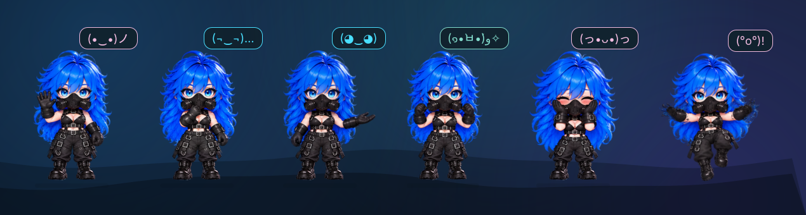

Animation follows Qt’s display animation clock. Each route contains 51 prepared frames, played at 60 Hz. Standing gestures hold their endpoint and return through the same frames. Hovering raises the hands into a gentle blush; clicking deepens the same sequence and opens or closes chat. The stronger reaction eases back to the hover pose while the pointer remains over the avatar. Dragging beyond the click threshold starts an alternating flail loop, with pendulum motion around the actual grab point and a softened shadow; releasing eases back into a standing pose. Interruptions reverse from the current frame before entering the latest requested gesture; an old gesture cannot jump back in after a newer request. Continuous breathing, restrained sway, attention and carrying/landing motion apply to the connected figure. Output-seam mirrors consume the primary avatar’s exact sample. Native GPU and software rendering use the same registered artwork, bounded lazy image caching and area-averaged textures for small desktop sizes.

The 76-clip catalog controls intent, priorities, timing and subtle movement; related clips share the six illustrated routes. Hover and click reactions can play during ordinary task activity, while approvals, errors, disconnects and dragging take priority. Focus in a chat draft means listening; live provider activity distinguishes thinking, replies and tool work. Permissions and problems take priority, and confirmed completion can celebrate. Idle energy, intensity and mood still control automatic acting. Automatic blinks use registered closed-eye frames at rest and gesture endpoints, avoiding a neutral face being pasted over a moving pose. **Settings → Motion & expressions** includes previews, including **Timid blush · hands to cheeks**. Reduced motion, zero intensity and quiet mode use the original still pose. Hidden avatars stop their animation clocks. Speech is configured independently under **Settings → Voice**.

The compact panel and workspace headers use a dedicated twelve-frame head portrait, with blinks, subtle head movement, pointer attention and a click-to-wink greeting. Connection problems, permissions and task activity take priority. A small speech indicator follows actual voice playback. Quiet mode, reduced motion and zero intensity stop the portrait's animation; hidden and minimized windows stop its animation clock.

The portrait estimates the tone of Cere's current English replies locally, using weighted phrases, negation, contrast, recent clauses and expressive punctuation. It excludes tools, code and quotations, fades old replies and resets when you switch conversations or send a new message. Short holds smooth changes during streaming. Ambiguous, unsupported-language and over-12,000-character replies stay neutral. This is a best-guess expression, not a reliable interpretation of sarcasm or proof of task success. **Respond to conversational tone** disables it independently of activity expressions. The portrait and full body consume one settled QML mood source, shared between UI and overlay hosts through attention updates. The existing 650 ms hold for competing non-neutral moods remains; body reactions occur at most once every six seconds. Busy activity, permissions, problems, disconnects and dragging take precedence, and blocked reactions are discarded rather than queued. The tone toggle governs both reactions and idle tinting. Conservative opening-phrase matching remains for user support and as a fallback if the shared QML source is unavailable; it never overrides a valid neutral classification. Mood-weighted selection favors matching gestures among the remaining bag entries (3:1) without duplicating entries or inventing task success. Each avatar uses `assets/{id}-portraits.png`; its built-in imagegen prompt is kept with the source art outside the repository.

Mood behavior is authored in `motions.json → bodyMoods`. Life multipliers below apply relative to the selected idle profile; unlisted channels stay unchanged. Preferred gestures bias order within the bag, not the total number of appearances across a complete bag.

| Mood | One-shot body reaction | Preferred idle gestures | Idle life multipliers |
| --- | --- | --- | --- |
| Neutral / ambiguous | None: no reliable cue | Normal pool | Unchanged |
| Curious | `curious` | `idleCurious`, `headTilt`, `surveyTurn` | Head ×1.15 |
| Thinking | `ponder` | `ponder`, `glassesAdjust` | Hands, sway ×0.8 |
| Happy | `buoyantBounce` | `buoyantBounce`, `heelRock`, `easySway` | Presence, sway, hands ×1.15 |
| Cheeky | `cheeky` | `idleSmug`, `explainSweep` | Head, hands ×1.1 |
| Skeptical | `skeptical` | `ponder`, `headTilt` | Sway, hands ×0.75 |
| Tender | `tender` | `idleSoft`, `attentiveRest`, `deepBreath` | Sway, hands ×0.65 |
| Concerned | `attentiveRest` | `attentiveRest`, `idleSoft`, `deepBreath` | Sway, hands ×0.55; head ×0.75 |
| Surprised | `doubleTake` | `lookAround`, `headTilt` | Head ×1.1 |
| Focused | `glassesAdjust` | `glassesAdjust`, `ponder`, `explainOpen` | Sway ×0.7; hands ×0.85 |
| Sleepy | `doze` | `deepBreath`, `idleSoft`, `attentiveRest` | Pace ×0.7; sway, head, hands ×0.6 |

Animation authoring separates reference registration, gesture intent and rendering:

- `assets/avatars.json` selects each avatar’s `assets/{id}-surface-rig.json` and `assets/{id}-portraits.png`. The shared `assets/cere-rig.json` retains the motion channels and stance definitions. Each surface rig registers its neutral and closed-eye cells, gesture frames, endpoint blinks and route mappings without changing painted aspect ratios.
- `assets/motions.json` owns clip priorities, timing, idle profiles, blink cadence and mood reactions. `qml/Motion.js` samples continuous acting; `qml/SurfaceMotion.js` handles frame travel, holds and interruption recovery. `qml/GesturePlayer.qml` combines them on one clock.
- `native/avatarpuppet.cpp` validates atlas geometry and lazily prepares the selected frame for GPU or software rendering. The desktop hit region includes every gesture silhouette. Each avatar's `registration.json`, kept with the source art outside the repository, records the source position, scaling and foot anchor used by the preparation tools.

After authoring, run `node --test tests/avatar-surface-motion.test.ts tests/avatar-animation.test.ts tests/assistant-identity.test.ts tests/avatar-settings.test.ts` and `ctest --test-dir build -R '^(motion|avatar|avatar-software|qml)$' --output-on-failure`. The asset checks verify original visible pixels, frame bounds, planted standing gestures, free carried feet and unclipped silhouettes across all five characters. `cere-ui-check connectedSurfacePoses` checks gesture playback, interruption, blinking, reduced motion and input regions at two scales. `cere-ui-check avatarPointerReactions` covers hover, stronger click, the drag threshold, carrying, release and urgent-state priority. Review the actual desktop as well: passing numeric checks does not establish visual quality.

**Settings → Companion → Avatar & colors** selects the avatar and matching theme. **Settings → Personality** controls the assistant’s name and conversation style. **Cere** is the default name and avatar; **Daemona** adds crimson skin, dark hair, horns and gothic clothing. **Jade** has scarlet hair, a black crown, feathered wings and a plaid skirt; **Nova** has violet-tipped dark hair, a half-up bun and purple jewelry. **Soap** has a brown mohawk, stubble, a tan tactical vest and navy clothing. All five characters use their matching images in `reference/`, share the gesture system and have twelve expression portraits. Choose **Save avatar** in Companion to apply an appearance. In Personality, enter a name of up to 64 characters (blank restores Cere) and choose **Save changes** to save the name and conversation style. Appearance and labels update immediately across the desktop pet, motion preview and conversation portraits; the chosen name reaches managed providers on their next turn. Avatar, name, personality and speaking voice are independent, and changes persist across restarts. Unsaved drafts survive unrelated setting updates; conflicting edits from another window require discarding the local draft before saving.

Saving an avatar also applies her theme: **Cere** uses cool blue; **Daemona** uses black, dark red and crimson; **Jade** uses black and vibrant reds; **Nova** uses black, violet and purple; **Soap** uses tan and muted navy. Colors follow the character throughout the compact panel, menus, conversation cards, portrait frames, desktop bubbles, mood badges, motion preview and live tray/window icon. The theme follows the saved avatar immediately and across restarts; unsaved selections leave the current theme in place. New artwork was generated with built-in imagegen; the selected source sheets and prompts are kept outside the repository.

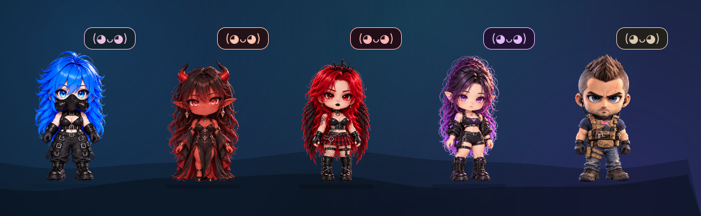

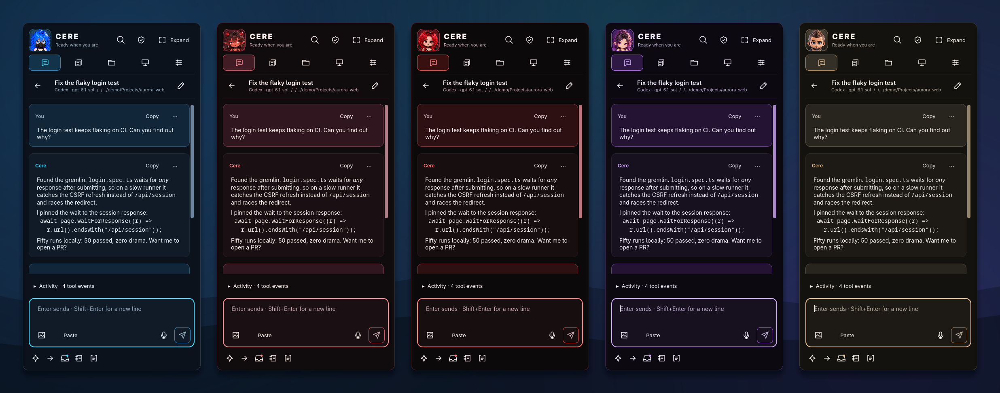

The default personality is a warm, sharp-tongued rogue; edit the multiline text to replace it, or save an empty personality field for a neutral voice. **Restore default personality** fills only the personality editor with the original text for review before saving. The selected name takes precedence over an old self-name in personality text without rewriting your saved text. Changes apply on the next turn in existing and new managed Codex, Claude, AntiGravity, Ollama and API conversations; running turns retain their current instructions. Personality and names do not change permissions or project instructions. External linked terminals retain their own configuration until handed to Cere. The application, integration names and window identifiers remain Cere.

## Sessions, workflows, and companion tools

- **Ctrl+K** opens unified navigation for sessions, folders, projects, settings, saved actions, transcript matches, bookmarks, and decisions, with favorites and recent commands. **Ctrl+N** opens a conversation; **Ctrl+,** opens settings. Settings search and interface scaling work independently of pet size.
- **Settings** shows one category at a time, grouped under Cere herself (Companion, Personality, Voice, Motion & expressions), Assistant (Connections, Knowledge, AI assistance, Saved scripts) and System (Cere Mobile, Workspace telemetry, Application): in a rail beside wide pages, or a scrolling strip of chips on narrow ones. **Find a setting** searches individual settings; Enter or a result opens its category, scrolls to the control, focuses it and outlines it briefly. Escape clears the search first. **Ctrl+K** lists the same categories and settings, and Desktop's **Manage scripts** opens Saved scripts.
- **Sessions → New folder** creates an organizational folder. Rename it, move sessions between folders or back to Unfiled, pin, archive, and filter by working directory or unread status. Deleting a folder preserves its sessions. Folder membership never changes a project path, permissions, or memory scope. **Delete…** in a conversation's context menu (right-click or Shift+F10) removes it after confirmation, together with its transcript, draft, attachments, queued messages and workflow results. Cere refuses while the conversation is working, waiting for an approval or running a power session. Project memory is kept. Temporary conversations offer **Discard…** instead.
- The composer supports reviewed file/image attachments with previews and individual removal, drag-and-drop, explicit clipboard import, revisioned draft recovery, quote-to-reply, and message bookmarks. Private attachment copies are removed once no draft, uncertain submission, or active turn needs them. **Context** shows attachments, destination, rough text usage, and recent memory evidence; native CLI history and filesystem access remain additional context Cere cannot fully measure.
- **Branch** creates a new conversation with selected, editable context. A separate Codex native-fork option requests an actual provider history fork and reports failure if unsupported; it never silently substitutes a text copy. Temporary conversations retain Cere transcript/drafts only in memory and exclude durable workflows, memory, and mobile access. They currently accept text only; external providers retain their own policies.
- **Project workflows** provides editable, revisioned capsules scoped to the exact project directory. Resuming creates an editable draft from the reviewed capsule. Four built-in recipes have typed inputs, pinned instructions, versioned definitions, exact previews, a one-turn limit and a 30–600 second deadline. Recipes do not grant access or send automatically. Substantial edits remain in the chosen editor.
- The result hub separates provider completion from verification, links observed artifacts and transcript evidence, and can run an explicitly reviewed saved check in the result’s project. Only its observed exit code establishes that check’s pass/fail; it does not certify the whole task.
- **Memory review** proposes decisions or constraints from a message with its supporting passage and source role visible. Confirm, correct, keep local, or discard the proposal. Existing inspector correction/forgetting controls remain available inline, including **Why was this recalled?**.
- Local push-to-talk records at most 60 seconds into a private temporary file and uses a user-configured local transcription executable/model. The transcript enters an editable review before the composer; there is no always-listening mode or automatic model download. Speech supports selected-text playback, rate adjustment, and an optional brief reading that preserves the full written response.
- **Offline tools** provides notes, tasks, arithmetic, conversions, and pause/resume/repeating timers. Reviewed workspace routines use exact previews; undo is offered only for created timers. Focus, Gaming, and Presentation profiles combine visibility, speech, animation and ordinary notification preferences while retaining approval access. Home positions are per monitor; edge docking is explicit.
- **Health and recovery** (**Settings → Application → Maintenance**, beside **Backup and restore**) distinguishes provider/authentication/protocol/network, memory, and speech problems. Diagnostics use an allowlist and must be previewed before export. Reviewed backups exclude credentials, device keys, active grants, executable actions and temporary conversations by default. Restore preserves the current forgetting registry, pauses tools, marks restored sessions interrupted, and never replays a turn. If forgetting records differ, old conversation/draft/attachment/notes payloads are omitted conservatively. Restoring keeps this computer's connections, API keys, paired phones, voice profiles, personality and other preferences, and clears project grants until you resume tools. Conversations, drafts, notes and project capsules come from the backup only when it includes them; a backup without them restores a profile without conversations. Restoration stages a new profile and restarts the broker (through `cere-broker.service` when installed); the previous private profile, including its conversations, is retained.

<table>
<tr>
<td width="50%" valign="top">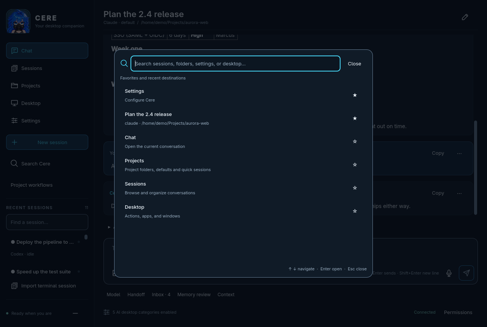<br>The command palette (Ctrl+K) with favorites and recent destinations.</td>
<td width="50%" valign="top">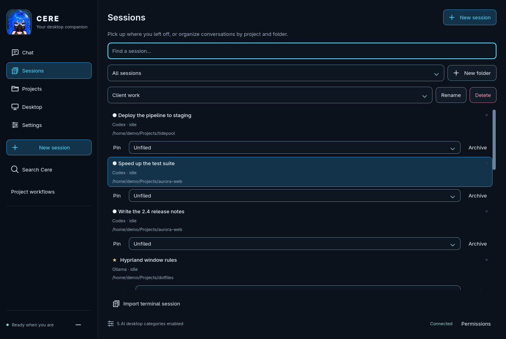<br>Sessions with filters, folders and pins.</td>
</tr>
<tr>
<td width="50%" valign="top">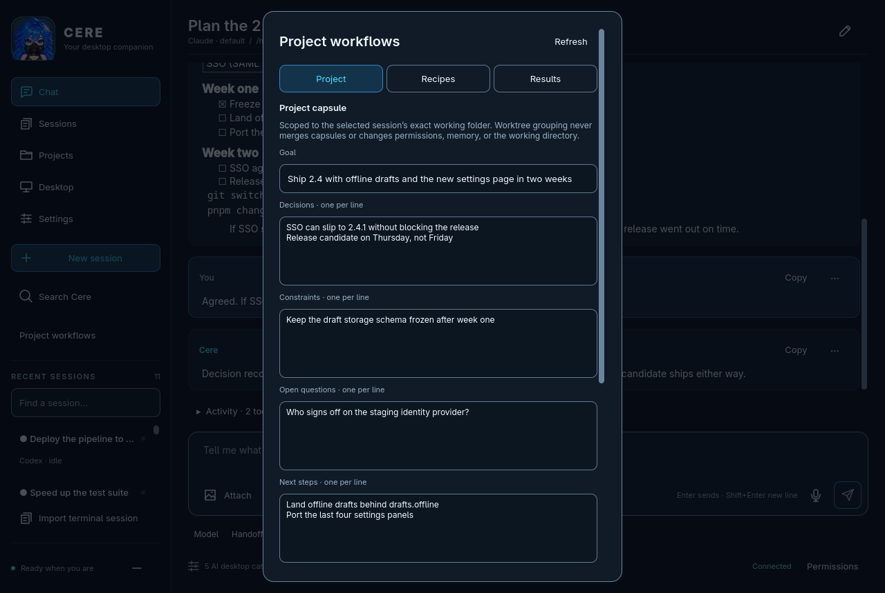<br>A project capsule in Project workflows.</td>
<td width="50%" valign="top">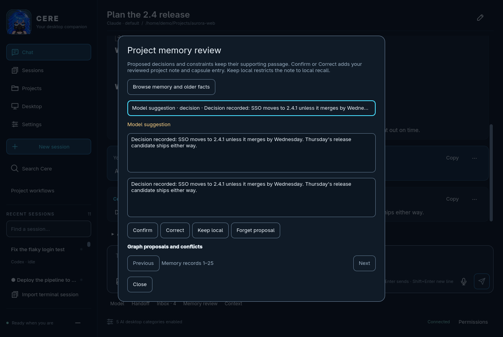<br>Memory review of a decision proposed from a reply.</td>
</tr>
</table>

## AntiGravity and direct APIs

**New session** offers **AntiGravity**, **OpenAI API**, **Claude API**, and **Google AI API** alongside Codex, Claude Code, and Ollama. They also appear in reviewed handoffs and branches. These four integrations currently execute on the desktop; mobile can read their conversations but cannot start or send their turns.

- **AntiGravity:** install the `agy` CLI and sign in interactively once. Cere discovers models with `agy models`, streams replies and tool activity, and resumes the conversation by its own ID. `CERE_ANTIGRAVITY_BIN` overrides the executable. Headless actions requiring approval are soft-denied by the CLI unless allowed in its settings or Cere's CLI permission bypass is enabled. Cere does not change global AntiGravity configuration. Text attachments are supported; image input and interactive permission questions are unavailable in this adapter.
  Model IDs ending in an effort, such as `gemini-3.1-pro-high`, already select that effort. Use **Provider default** or the matching effort under **Model**; conflicting saved selections are rejected before dispatch. Provider failures include the CLI's error details.
- **API providers:** add a key in **Settings → Connections**, then connect to load the account's models. Select a model or enter an explicit model ID when creating a session. Standard broker environment variables also work: `OPENAI_API_KEY`, `ANTHROPIC_API_KEY`, and `GEMINI_API_KEY` (or `GOOGLE_API_KEY`). Saved keys take precedence; removing one restores any environment key. Keys are stored in an owner-only file under Cere's state directory, separate from SQLite, snapshots and reviewed backups. Replacing or removing a key stops its active API turns. API usage is billed by the provider, separately from chat subscriptions.
- APIs support streaming, local conversation history, image/text attachments, optional desktop tools and Codex/Claude delegation, web search, and shared memory under the existing cloud-sharing setting. Tool availability also depends on the selected model. Requests use each provider's native API and do not follow redirects or automatically retry ambiguous failures. OpenAI responses use `store:false`. Cere keeps a bounded working context; API models without advertised context limits use a conservative 32,768-token budget. Claude API requests ask for the model's advertised output limit, or 4,096 tokens when the catalog lists none. A reply that reaches a model's output limit is kept, marked as stopped there and kept in the model's history, so you can ask Cere to continue. Model reasoning settings use provider defaults.

OpenAI, Claude API, Google AI API and Ollama requests automatically retry HTTP **429, 500, 502, 503 and 504** up to three times, waiting 1, 2 and 4 seconds plus up to 25% random jitter. `Retry-After` is honored within the request deadline and a 60-second maximum wait; a longer server requirement fails without retrying early. Other statuses, including 400/401/403/404, fail immediately. Transport failures with uncertain outcomes and streams that have already started are never replayed. **Stop** cancels pending waits. Broker retry logs contain the status, retry count and delay; cloud API conversations also show retry progress in activity. The reusable `withHttpRetry` wrapper lives in `broker/http-retry.ts`.

Use **Model** below the conversation composer to choose a model for your next message. This works within the current provider for Codex, Claude Code, AntiGravity, the three cloud APIs, and Ollama. Wait for the current response or press **Stop** first. The conversation, draft, attachments and CLI conversation ID stay in place; other sessions and defaults are unaffected. CLI reasoning options follow the selected model. API conversations also accept a custom model ID when the catalog is unavailable; changing models keeps readable history and recorded tool results while discarding model-specific reasoning/signatures from the working context. The new API model must support the images and tools you use. From a phone, model changes are available in idle Ollama, Codex and (with restricted mode available) Claude Code conversations that the phone started.

Protocol references: [AntiGravity headless mode](https://www.antigravity.google/docs/cli/headless/), [OpenAI Responses streaming](https://developers.openai.com/api/docs/guides/streaming-responses), [Claude Messages streaming](https://platform.claude.com/docs/en/build-with-claude/streaming), and [Google GenerateContent](https://ai.google.dev/api/generate-content). AntiGravity receives recalled memory context when cloud sharing is enabled; Cere's automatic MCP tool installation remains specific to Codex and Claude Code.

## Ollama

Run an Ollama server, then open **Settings → Connections**. The default address is `http://127.0.0.1:11434`; **Connect** accepts another HTTP(S) server or reverse-proxy base URL. **Refresh** reloads its chat models. Choose a **Default model for new conversations**, or select a model when opening each session. Pull models with Ollama itself; Cere does not download or delete models automatically. Embedding-only models are excluded and cloud-backed models are labeled **Cloud**. Cloud authentication stays with your Ollama server.

Choose **Ollama** in a new session for streaming conversation. The project folder is optional in conversation mode. The **Model** button changes an idle conversation’s model or enables assistance; existing context is retained. Defaults affect new sessions, and each session keeps its server address even if the connection setting changes. Image-capable models accept explicitly attached PNG, JPEG and WebP files (10 MB each, 20 MB combined, up to four). Thinking uses the model’s defaults and is retained in provider context without cluttering the transcript.

For orchestration, select a model marked **Tools**, enable **desktop tools and delegation**, and trust the project folder. Under **Settings → AI assistance**, enable the categories you want:

- **Provider orchestration** lets Ollama start Codex or Claude tasks in the same project, send follow-ups, wait for and read results, and stop its delegated sessions. Unless a project power session grants CLI access, each task or follow-up asks you to review the exact prompt and provider first, including under Broad control. Delegated sessions appear in Sessions and retain their provider’s own approvals. Ollama can manage only sessions it created.
- **Saved scripts** lets it list and run explicitly configured executables with their saved arguments, including other CLIs. Execution follows the same approval and grant rules as Cere’s existing script controls.
- Desktop categories allow application/window discovery, desktop actions, media and volume controls, timers, and approved captures. Captures require a separate sharing approval before an image-capable model receives the image, unless that session has active computer-control power access.

**Stop** cancels the Ollama request and active delegated turns started during that turn. Turning off assistance categories or pausing AI actions prevents further tool execution. Tool loops stop after 24 model responses (up to 16 requested tools per response), and a stalled HTTP request times out after three minutes. On broker restart, incomplete turns stay interrupted; unresolved tool calls are recorded as having an unknown outcome and are never replayed automatically.

Cere uses Ollama’s [native chat API](https://docs.ollama.com/api/chat) and [streaming tool protocol](https://docs.ollama.com/capabilities/streaming). Conversation content and approved attachments go to the configured server; **Cloud** models are processed through Ollama Cloud. `CERE_OLLAMA_HOST`, then `OLLAMA_HOST`, supplies the initial address when no connection has been saved. Existing installations gain these settings without a database migration.

## Web search

Enable **Settings → Knowledge → Web search** for Ollama conversations. It works in Conversation mode and Assistant mode without desktop permissions. Models with native tool support receive `web_search` and `web_read` and are instructed to use them when asked, for current facts, or when their knowledge is uncertain. Tool use still depends on the model. Check **Search web** beside the message box (**Web** in compact windows) to search first with any chat model, including models without tool support. This sends your next message as a public query, up to 500 characters; the choice resets after sending.

Choose **DuckDuckGo**, **Brave**, **Mojeek**, or **SearXNG**. The first three read public search pages without an account or API key. **Automatic** tries DuckDuckGo first, then Brave and Mojeek on failure or unusable results, and reports fallback. Selecting an individual provider keeps queries with it. For SearXNG, enter its base URL and enable `json` in its `search.formats`. Cere uses only that instance; it does not choose a random public server. Search starts disabled.

Replies include clickable source buttons; the Activity Panel shows queries, results, and errors. Public providers sometimes return CAPTCHA pages or rate limits; Cere reports these failures instead of treating a blocked page as evidence. The reader accepts public HTTP(S) HTML/text, strips scripts and navigation, and bounds page size and returned text. It checks resolved addresses and every redirect, refusing private, loopback, link-local, shared, multicast, reserved, documentation and benchmarking IPv4 ranges. It also refuses the IANA protocol-assignment block 192.0.0.0/24, including its anycast services, and the deprecated 6to4 relay range 192.88.99.0/24; the rest of 192.0.0.0/16 is public. IPv6 is limited to global unicast outside the special-purpose, 6to4 and documentation ranges. The explicitly configured SearXNG endpoint can be local. Reading a source contacts its website. Stop cancels research, and pausing AI actions or disabling search prevents further tool use. Research is limited to eight tool calls per turn. Pages and snippets are untrusted reference material.

<p align="center">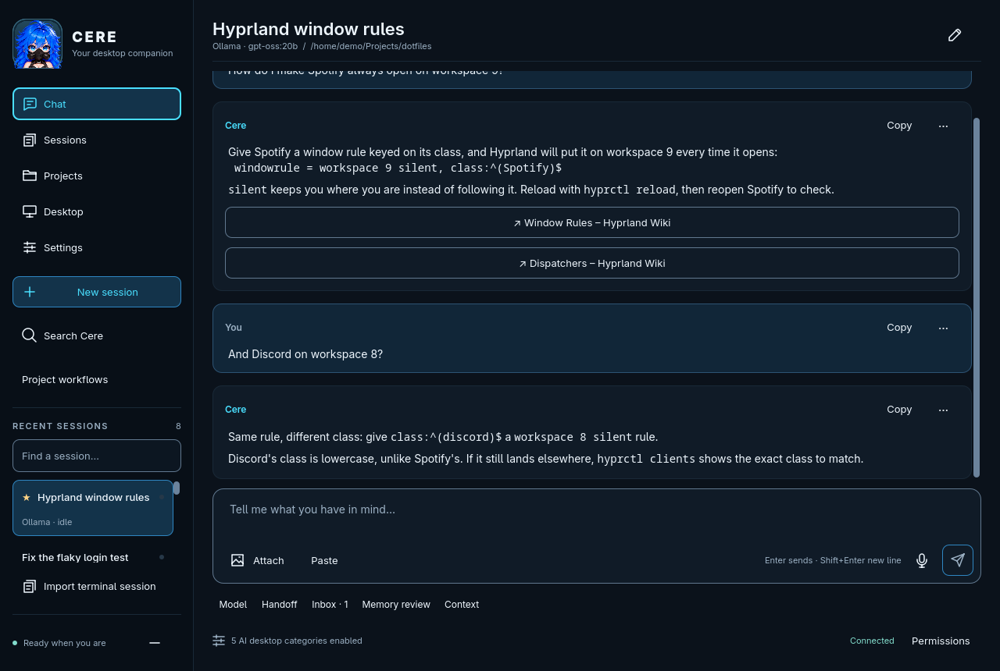</p>

## Shared project memory

Graph memory is integrated into the broker and native inspector. **It remains experimental:** the full reference design’s release criteria have not all passed. See [implementation status](docs/memory/implementation-report.md) and [evaluation results](docs/memory/evaluation.md) for measured results and remaining work.

Enable **Settings → Knowledge → Memory → Remember and recall conversations**. Memory starts disabled. The default extraction model is **`glm-5.3-flash:cloud`**, an Ollama Cloud model; Settings can select another. Its evaluation is in [the memory evaluation](docs/memory/evaluation.md#extraction-through-canonical-memory-ev-01). The default embedding model is **`nomic-embed-text`**. Both must already be registered with the configured Ollama server. Cere does not download models automatically. Cloud-backed embedding models are refused, so memory text is never sent to a cloud-backed model for embedding. Cloud extraction and sharing recalled memory with a cloud chat model are separate settings: cloud extraction is configured for the selected model, while cloud recall starts disabled. Sources marked local-only cannot be dispatched to cloud extraction.

Managed Codex, Claude and Ollama conversations share the same memories for the same project and memory server. Codex and Claude use the Ollama server selected in **Connections** for embeddings; existing Ollama conversations retain their saved server. Enable **Share recalled memory with Codex, Claude and cloud models** to supply recalled context to these providers. Before a turn whose message names a topic, Cere supplies bounded context when relevant memories are found. It records completed replies with their source roles. Native providers also receive the shared memory tools through Cere's session-scoped MCP connection. Standalone CLI sessions outside Cere do not automatically receive this connection. Existing project/server scope keys are preserved; changing providers does not copy or migrate the data.

Canonical observations, exact source witnesses, entities, typed assertions, correction history, episodes, and erasure records live in private SQLite at `$XDG_STATE_HOME/cere/graph-memory/memory.sqlite`. Neo4j and Qdrant are rebuildable local projections. Their pointers are checked against canonical scope, time, revision, policy, and erasure state before text is recalled. See [operations](docs/memory/operations.md) for authenticated dependency setup, Fish integration, backup, restoration, and reindexing.

**Manage project memory** opens saved notes and conversation passages for the selected conversation’s project folder and Ollama server. The **Graph, evidence and workspace inspector** adds temporal queries, provenance, structured corrections, conflicts, collector policy, indexing status, and forgetting progress. Structured corrections require an exact source quotation and the inspected revision. Uncertain effective dates remain candidates for review. Identity decisions are reversible: “same” makes recall treat two entities as one, “not the same” keeps them apart even when other links would join them, and “possible” is only a note for review. Records are never rewritten, so reverting a decision splits the entities again. Model text alone cannot establish that an action succeeded.

<table>
<tr>
<td width="50%" valign="top">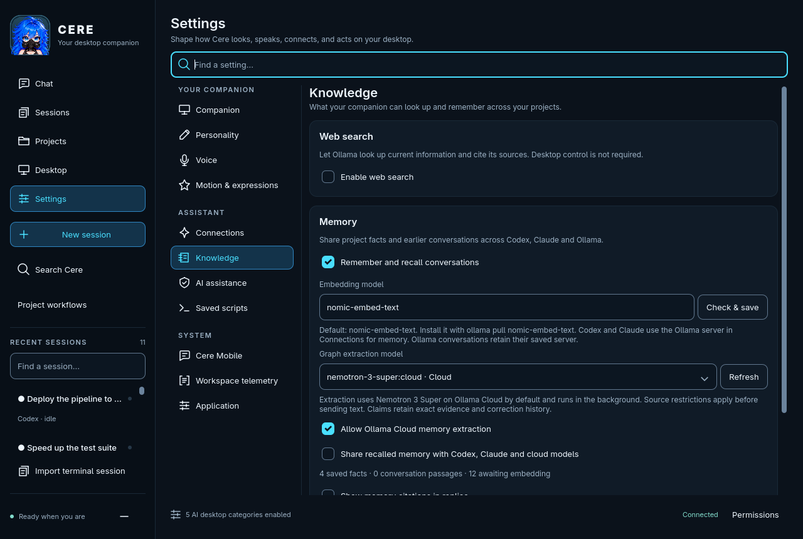<br><b>Settings → Knowledge</b> with memory enabled.</td>
<td width="50%" valign="top">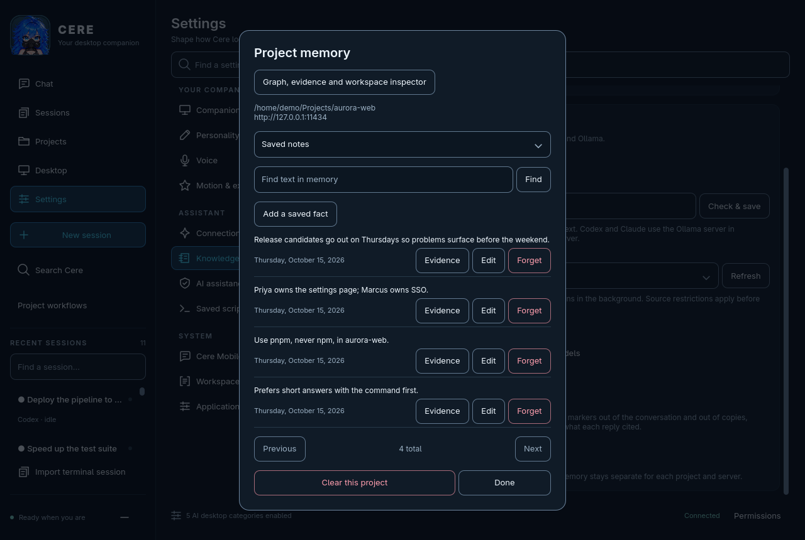<br>Saved facts for a project in <b>Manage project memory</b>.</td>
</tr>
</table>

Replies that use recalled memory cite it inline as `[evidence:ID]`. These markers are hidden by default: conversations, completion and pinned-reply cards, Activity results, the completion inbox and command-palette snippets leave them out, and so do Copy, Quote, Branch and Speak. Turn on **Settings → Knowledge → Memory → Show memory citations in replies** to see them. Saved replies keep every marker, so the record of which evidence each reply cited is unchanged, and spoken replies never read them aloud.

Writes commit before embedding, so saved decisions are available to lexical recall even while indexing is unavailable. Retrieval degrades with explicit coverage when a model or projection is down. Memory enters the prompt as delimited untrusted data, with separate records of evidence supplied to the model and evidence actually cited. Recent chat context still uses a bounded prompt window with complete tool request/result pairs. A reply waits at most eight seconds for memory, and the conversation shows **Recalling memory…** meanwhile. After that the reply goes ahead without recalled context and memory shows as degraded. Stop ends the wait at once.

Forgetting suppresses use immediately, scrubs matching passages from Cere’s managed conversation history, and reports physical deletion separately while projection acknowledgements are pending. A forget preview walks only records that are not yet erased, and it gives up after 30 seconds instead of holding memory. If a memory request runs far past its limit, Cere stops it and restarts memory while replies continue. Keep the current external erasure registry when restoring any backup; an older backup alone must not resurrect forgotten content. External provider histories and copies exported outside Cere are not managed by this workflow. Disabling memory stops normal capture and recall without deleting retained records.

Architecture, configuration boundaries, and pinned versions are documented in [architecture](docs/memory/architecture.md), [policy](docs/memory/policy.md), and [versions](docs/memory/versions.md).

## Permissions and persistence

Desktop AI categories start disabled. Scoped assistance enables chosen categories and asks before sensitive tools. Broad control is optional and requires project-specific, expiring grants. Pause and revoke remain available. Cere’s grants govern its own MCP tools; they do not sandbox unrelated shell access already granted to a CLI.

**Permissions** opens a single center for effective access, provider state, project grants, expiry, revocation, and separate controls for pausing Cere actions and stopping provider work. **Settings → AI assistance** also has two switches that stay on until you turn them off. **Skip CLI permission prompts** approves project trust, commands, file changes, scripts and delegation in managed conversations, and auto-approves CLI requests from paired phones that hold both `providers.execute` and `approvals.provider` (see [mobile security](docs/mobile/SECURITY.md)). It also starts new `cere terminal` sessions with `--dangerously-bypass-approvals-and-sandbox` (Codex) or `--dangerously-skip-permissions` with the sandbox disabled (Claude Code). **Skip computer permission prompts** approves desktop actions. Questions always require an answer.

<table>
<tr>
<td width="50%" valign="top">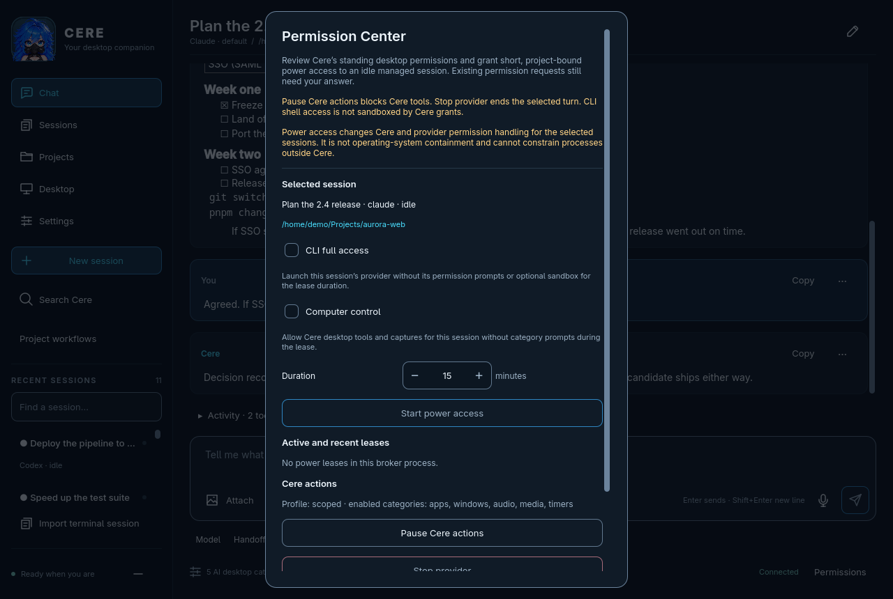<br>The Permission Center for the selected session.</td>
<td width="50%" valign="top">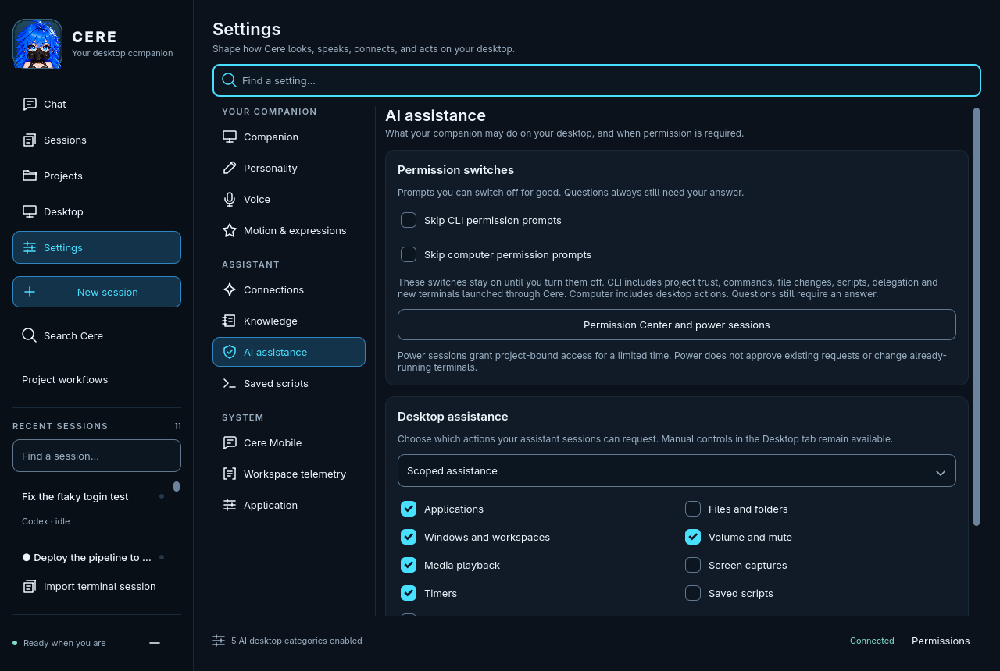<br><b>Settings → AI assistance</b>: permission switches and desktop categories.</td>
</tr>
</table>

**Power sessions** deliberately grant CLI full access, computer control, or both to selected idle, locally managed sessions in one canonical project directory. Leases last 1–120 minutes, remain visible, are never persisted, and must be renewed deliberately. Temporary, remote, and linked sessions cannot start one. Enabling power does not accept existing pending requests; questions always require answers. Ending or expiring a lease revokes new authority immediately and stops owned provider work, reporting confirmed or unconfirmed termination. Leases do not reach linked terminals, which keep their own permission configuration unless launched while **Skip CLI permission prompts** is on.

CLI full access can control the desktop through shell commands. Cere’s desktop permission categories do not contain unrestricted CLI processes. **Pause Cere actions** blocks Cere tools; **Stop provider** interrupts provider work. External provider or administrator restrictions still apply. Editing a saved executable invalidates review of its previous definition.

Markdown renders during streaming and when stored sessions reopen. Message Copy preserves the original Markdown, without memory citations while they are hidden; text selection copies the rendered text. Links open only on activation, and file links resolve against the session’s project directory. Tool output remains literal text. Wide tables can scroll horizontally.

Provider approvals remain separate from Cere’s desktop approvals. Codex file-change approvals show the proposed diff, network approvals name the destination, and approvals for input to a running command say so. Unknown provider requests fail closed with an explanation. MCP forms support strings, booleans, numbers, integers, and multiple selections from string lists, including optional fields. URL requests show the destination and require explicit browser opening and confirmation. Other complex forms are declined with an explanation. The adapters are checked against the [Codex app-server protocol](https://learn.chatgpt.com/docs/app-server) and [Claude Code headless mode](https://code.claude.com/docs/en/headless). They were last validated with Codex 0.162.1 and Claude Code 2.1.296 on October 12, 2026. Cere requires Codex 0.158.0 or newer and Claude Code 2.1.259 or newer, and reports an older CLI as needing an update. Authentication and billing remain with each CLI.

State is stored in `$XDG_STATE_HOME/cere/cere.sqlite` (normally `~/.local/state/cere`), using private filesystem permissions. It includes settings, drafts, conversation messages, recent action metadata, and timers. Screenshots live in the sibling `captures` directory. Codex and Claude transcripts remain in their native locations. Ollama’s full conversation context, tool results, and explicitly shared images are stored in Cere’s private database. Enabled graph memory also publishes eligible projections to the configured local Neo4j and Qdrant services; selected cloud extraction uses Ollama Cloud.

Cere IPC uses a private Unix socket at `$XDG_RUNTIME_DIR/cere/broker.sock`; enabled Fish collection uses `$XDG_RUNTIME_DIR/cere-memory/memory.sock`. Connections require the same OS user. Cere opens no TCP listener by default. The optional Android companion gateway listens only on explicitly selected LAN/WireGuard addresses after local offline pairing; see [mobile setup](docs/mobile/SETUP.md) and [implementation limits](docs/mobile/TESTING.md). Configured Ollama and memory dependencies use HTTP(S) or Bolt, with the packaged database ports restricted to loopback. MCP subprocesses receive session-scoped random capability tokens. A UI restart leaves broker work running. A broker restart marks incomplete turns interrupted and never silently replays them. Restart the installed broker with `systemctl --user restart cere-broker` only when you intend to interrupt its active work.

For isolated development, set `CERE_STATE_DIR` and `CERE_RUNTIME_DIR`. Set `CERE_CODEX_BIN` or `CERE_CLAUDE_BIN` to an executable path when testing a different provider build. Managed conversations, provider detection, model catalogs and Codex history import all use that executable; `cere terminal` still runs the CLI found on `PATH`. Without an override, the broker looks on `PATH` and then in `~/.local/bin`, where both CLI installers put their launchers, and adds `~/.local/bin` to the `PATH` its provider processes inherit.

## Validation

```sh
npm test
npm run typecheck
npm run build
ctest --test-dir build --output-on-failure
QT_QPA_PLATFORM=offscreen:configfile=$PWD/tests/fixtures/offscreen-scales.json QT_QUICK_BACKEND=software QT_QUICK_CONTROLS_STYLE=Basic ./build/cere-ui-check
```

`ctest` runs the motion, avatar (GPU and software) and QML component tests; the QML tests need `QML_XHR_ALLOW_FILE_READ=1`, which CTest sets. The offscreen UI run uses virtual outputs at several scales and skips checks that need the live Hyprland compositor or desktop session, such as Spotify, Satty and layer-shell placement. Run `QT_QUICK_CONTROLS_STYLE=Basic ./build/cere-ui-check` on the live desktop for those; it moves the pointer and controls the running Spotify. For the locally extracted dependencies, prefix the UI test with `LD_LIBRARY_PATH="$PWD/.local-deps/usr/lib" QT_PLUGIN_PATH="$PWD/.local-deps/usr/lib/qt6/plugins"`. Native tests briefly open isolated test windows and write screenshots to `/tmp/cere-ui-evidence`.

After `cmake --build build --target cere cere-screenshots`, `tools/screenshots/run.sh` regenerates the documentation images in [`screenshots/`](screenshots/README.md) from a scripted demo profile. It renders offscreen inside private user, mount, process and network namespaces, so it uses no real Cere profile, compositor, provider account or network. Name capture slots, such as `settingsPages`, to retake only those images.

`tools/live-check.ts` runs real provider calls in a temporary project, including a named harmless printf script, approval, another turn, and a process disconnect/resume. It consumes normal CLI usage. Run it only with isolated `CERE_STATE_DIR` and `CERE_RUNTIME_DIR` values. `tools/probe-providers.ts` is a smaller no-tool connectivity check.

`node tools/check-ollama.ts MODEL [codex|claude]` exercises real Ollama conversation, recall after disconnect, an approved saved `printf` command, and optional provider delegation. It creates its own isolated broker/project, uses normal provider usage, and prints the evidence directory containing `report.json`, `broker.log`, and the test database. Only the known test command and exact test delegation are approved. Backend tests and native UI checks use local Ollama fixtures with no inference usage.

The avatar source art, transparent extractions, eyelid edits, gesture sheets, portraits and built-in imagegen prompts are kept outside the repository. The preparation tools and the source-pixel check in `tests/avatar-surface-motion.test.ts` read them from `artwork/avatars/`; without that directory the check is skipped. Rebuild the deterministic runtime assets with Sharp (from `npm ci`) and OpenCV for offline interpolation:

```sh
c++ -O2 -std=c++17 tools/interpolate-avatar-poses.cpp -o build/interpolate-avatar-poses $(pkg-config --cflags opencv5) -lopencv_video -lopencv_imgcodecs -lopencv_imgproc -lopencv_core
node tools/prepare-avatar-references.mjs
node tools/prepare-avatar-poses.mjs build/interpolate-avatar-poses
node tools/prepare-avatar-portraits.mjs
```

On systems packaging OpenCV 4, use `opencv4` in the compile command. Interpolation is an offline authoring step, not a runtime dependency. Intermediate frames go under `build/avatar-frames/`. The retired sprite/cutout assets and their preparation tools have been removed. Desktop branding retains `assets/cere-emblem.png`; `tools/prepare-icons.mjs` generates launcher icons, and its prompt is kept with the source art.

`node tools/check-knowledge.ts [MODEL]` checks real `nomic-embed-text` recall, restart persistence, public search, and source reading in a temporary project. Supplying a model also tests native search/memory tools and the use of recalled context, with synthetic facts only. `MODEL --memory-only` or `MODEL --web-only` repeats just that model tool check. The script prints its private evidence directory. `build/cere-ui-check searchAndMemory` exercises settings, the embedding check, memory editing, explicit search with a plain chat model, and source links against local fixtures. Production HTML-parser dependencies are bundled with installed Cere.

See `VALIDATION.md` for the checks performed on this machine and the remaining platform coverage limits.
