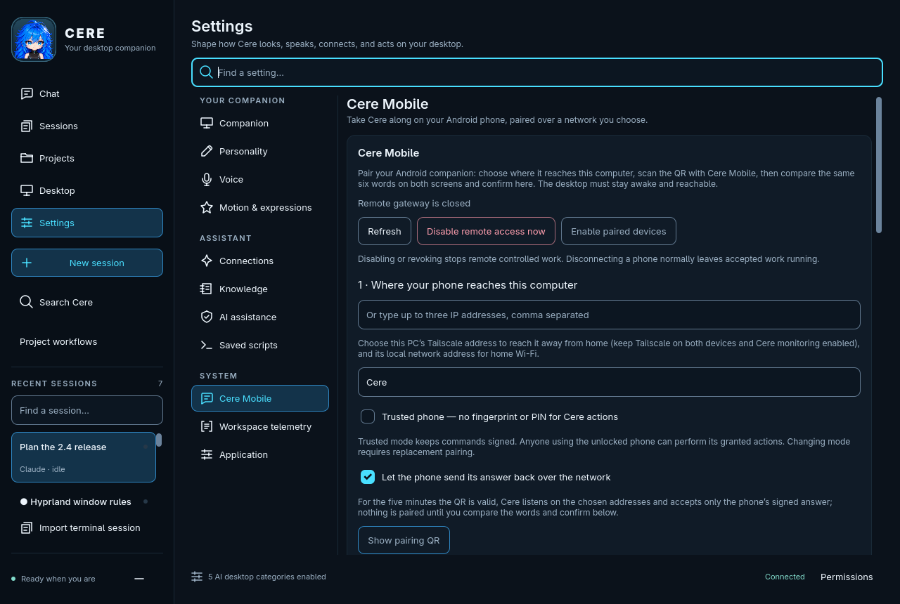

# Cere Mobile setup

The Android client lives in [`mobile/android`](../../mobile/android/README.md). It needs Android 11/API 30 or newer; this build targets Android 17/API 37. Desktop Cere remains responsible for providers, tools, projects, memory and timers. Keep the desktop awake and connected. The app needs no Google Play services, account server or relay, and does not configure router forwarding or firewall rules automatically.

## Build and install for development

Use JDK 17 and an Android SDK containing platform 37 and Build Tools 36.0.0. The checked-in wrapper and dependency verification metadata pin the Android build. Run:

```sh
cd mobile/android
./gradlew :core:protocol:test :core:data:testDebugUnitTest :app:lintDebug :app:assembleDebug
adb install -r app/build/outputs/apk/debug/app-debug.apk
```

The debug package is `dev.otectus.cere.mobile.debug`; it can coexist with the future signed stable package, `dev.otectus.cere.mobile`. Do not treat a debug signing key as a release identity. The Cere face PNG and its generation prompt are in [`mobile/artwork`](../../mobile/artwork/).

Build the matching desktop source with `npm ci` and `npm run build`. Installed desktop packaging includes the gateway, protocol files and Node dependencies. `openssl` creates the private desktop pairing certificate. Starting the desktop does **not** enable network listening: the gateway listens only for a paired phone, or for the five minutes a network-return pairing QR is shown.

## Pair locally



1. On desktop, open **Settings → Cere Mobile**. Under **Where your phone reaches this computer**, tick this PC's addresses the phone should use: its Tailscale address for away from home and its local network address for home Wi-Fi (Cere lists the addresses it finds; you can also type up to three literal IPs). Wildcard listening is rejected. The default TCP port is 8443.
2. Leave **Let the phone send its answer back over the network** on and choose **Show pairing QR**. The desktop selects biometric actions or **Trusted phone — no fingerprint or PIN** in the signed offer. For the five minutes the QR is valid, the gateway listens on the chosen addresses and accepts only the phone's signed answer to this offer; nothing is paired until you confirm.
3. In Cere Mobile, give the phone a recognizable name and tap **Scan pairing QR** (or paste the offer's complete `cere-pair://v1/…` text and tap **Verify offer**). Biometric mode authenticates action-key creation; trusted mode creates a separate non-exportable signing key without a biometric prompt. Cere asks to show notifications, so approval requests can reach a locked phone (declining doesn't stop pairing), and on Android 17 for local-network access. The phone then sends its signed answer to the PC by itself, pinned to the certificate in the QR.
4. The desktop shows the phone's name and **six words**. Compare them with the phone. Select exact approved project folders (Cere lists the projects it knows; you can type others) and the capabilities, or start from a preset (**Chat only**, **Chat and approvals**, **Chat, approvals and coding agents**). Native provider execution loads those projects' CLI configuration. Desktop ordinary permissions still apply; local bypass switches never expand remote authority. An Ollama grant pins the current desktop Ollama server as well as its projects.
5. Tick **All six words match the phone** and choose **Confirm pairing and enable gateway**. The phone learns of the confirmation by itself, saves the pairing and shows **Online**. Connection status does not guarantee a particular provider is installed or authorized.

If two different phones answer the same QR (someone else scanned it), the desktop cancels that offer and pairs neither; show a new QR. **Cancel this offer** ends a QR early.

**When the answer can't travel over the network** (a firewall, the phone on another network, or **Let the phone send its answer back** turned off for offline pairing): on the phone, choose **Send the answer another way**, then copy or share the signed public response to the PC and paste it, or save it as a text file and choose **Load response file…**; choose **Verify pasted response**, compare the six words and confirm on the desktop. Then tap **I confirmed on the PC** on the phone: it asks the PC first and saves the pairing only once the PC has it, so a pairing the PC never confirmed is not kept. If the PC can't be asked, the phone says so and saves only if you choose to.

Pairing turns on background monitoring, which keeps a private persistent notification and the connection while Cere is closed. Turn it off in Settings → **Monitor in the background**; Cere then connects only while it is open and disconnects shortly after it leaves the screen. The notification's Stop action ends background monitoring; it does not cancel an already accepted desktop turn. Use the session's **Stop** control to interrupt that work. Android force-stop, a locked work/private profile, desktop sleep, a missing VPN or battery restrictions can prevent delivery. Settings shows battery status and opens Android's battery settings; the app never silently requests an exemption.

## Access away from home

Install Tailscale on the PC and Android phone, sign both into the same private network, and use the PC's stable Tailscale IPv4 address for Cere pairing. No exit node, subnet router, public reverse proxy, or router port forwarding is needed. Keep Tailscale connected, Android's **Always-on VPN** enabled, and Cere's **Monitor in the background** enabled. The PC must remain awake with the broker running. Tailscale may carry the encrypted connection directly or through an encrypted relay.

Limit access to the intended phone and TCP 8443 using Tailscale grants or the host firewall. On Linux, Tailscale's default netfilter rules can accept tunnel traffic before UFW rules. If using UFW as the access boundary, verify an active default-deny policy, add an exact phone-IP → desktop-IP TCP 8443 rule on `tailscale0`, then configure `tailscale set --netfilter-mode=off`. This setup assumes no subnet routing or exit-node service; those need their own firewall rules. Do not disable the host firewall. Confirm with an actual connection from cellular data, not merely a successful Tailscale ping.

The gateway now retains its enabled setting while configured interfaces are missing, retries listeners every 20 seconds, and keeps working interfaces available. A transient network loss does not stop already accepted remote work. Explicit **Disable remote access** and device revocation still stop remote-owned work.

### Upgrade a paired phone without losing drafts

Update both the broker and Android APK first. In Desktop Settings → Cere Mobile, enter the Tailscale address, explicitly confirm **Update gateway addresses / certificate**, then choose **Replace pairing** for the current phone. Select **Trusted phone — no fingerprint or PIN** if desired and prepare the new offer. Updating endpoints renews the certificate using the existing TLS key and desktop signing identity; each existing phone must import a replacement pairing to trust the new certificate.

On Android, use **Replace pairing** in Settings and import the new offer. It must name the currently paired desktop/device and prove continuity with the pinned keys. Review the exact authentication mode and compare the six words before desktop confirmation. Replacement preserves same-project identifiers, drafts, cached conversations, and local image drafts; it refuses unresolved pending commands or unfinished uploads instead of replaying/dropping them. Reconcile those operations before replacing: Settings → **Unconfirmed desktop actions** lists each one; check it on the PC, then choose **Checked**. Committed replacement revokes the old phone keys and transfers its stopped, still-authorized remote sessions to the new device identity. Old signing aliases are removed only after the new encrypted cache has been saved.

Trusted mode signs the same challenges and exact command payloads using a separate Android Keystore action key without requiring fingerprint/PIN. It does not disable signing, pairing, project scopes, revocation, or explicit Allow/Delete choices. The broker advertises the locally selected mode; unknown modes and trusted-pairing/legacy-broker mismatches fail closed. The phone's normal lock screen, Android/VPN setup consent, and account sign-in remain system responsibilities. Anyone using an unlocked trusted phone can exercise its grants.

## If pairing succeeds but the phone stays offline

First check that desktop `cere remote status` reports an enabled listener and that Android has local-network permission with **Monitor in the background** enabled. On a desktop using UFW, kernel entries containing `UFW BLOCK` and `DPT=8443` identify a firewall block. Add an administrator-approved TCP rule for the phone's source IP, the desktop's selected IP/interface, and the configured port. Do not disable the firewall. For example, replace the placeholders before running:

```sh
sudo ufw allow in on DESKTOP_INTERFACE proto tcp from PHONE_IP to DESKTOP_IP port 8443 comment 'Cere phone'
```

This rule needs updating if DHCP changes either address. A changed desktop address also needs an updated signed pairing endpoint. A successful TCP probe alone does not prove authentication: verify **Online** on Android and that the same phone appears in desktop `remote status` under `connected`.

If the app reports missing pairing keys, install the corrected build, revoke that device on desktop, then use **Forget desktop** and pair again. If it reports that a fingerprint or screen-lock change reset the action key, choose **Replace pairing** for this phone on the desktop; if it reports that the desktop certificate expired, first choose **Update gateway addresses / certificate**, then **Replace pairing**. Replacement keeps drafts. Automatic reconnection stops only when the pairing no longer matches the desktop, on revocation, for incompatible versions, or when the desktop keeps refusing the phone for several minutes; network faults and a phone clock that is off keep retrying. Android Keystore private keys cannot be reconstructed from the saved public pairing details. Reconnects are not rate-limited, but the desktop accepts at most ten simultaneous phone connections. Connections that drop without closing are cleared within two minutes, so after many interrupted retries, wait that long before checking a single new attempt.

## Manage access

Desktop settings can disable the gateway, revoke a phone, reduce/change its grants, renew a live device for 90 days, or clear its retained uploaded images. Disable and revoke stop remotely controlled work and close sockets. Ordinary phone disconnection leaves accepted work running. Renewing a device does not add capabilities.

Grants that the phone uses with protocol 1.1 (desktop Settings → Cere Mobile):

- **Hosted and compatible APIs**: `providers.api` plus each provider the phone may run (OpenAI, Claude, Google, Compatible endpoint). These may be billed to the desktop's keys. A compatible grant names one endpoint origin: the Settings endpoint's, or a saved connection you choose when granting. Each conversation is checked against its own connection, before every request: a desktop conversation on another saved connection stays readable but cannot be sent to, configured or listed from the phone, and a connection edited while a phone's message is being prepared stops that message instead of reaching the new destination. Changing the endpoint on the desktop needs a new grant. AntiGravity stays desktop-only: its headless mode cannot prove restricted execution.
- **Files, Images and Analysis** stay on the desktop. A desktop conversation that uses them can still be continued from the phone, but only after the phone says which of them pause while it is in control; they return, as selected, when the desktop detaches the phone. Their results show on the phone as cards to view on the desktop.
- **Memory**: `memory.read`/`memory.write` and the memory server (Ollama host) the conversation uses. Memory then works for any provider's conversation in a granted project, as on the desktop.
- **Capture**: Desktop control with the capture category starts screen captures; `capture.preview` lets the phone see them and `attachments.write` attach the reviewed image to a message. Editing in Satty waits for someone at the desktop.
- **Desktop draft attachments**: with `attachments.write`, the phone can send a desktop draft's attachments exactly as it reviewed them; with `capture.preview` it can preview images among them.

A phone shows only what both sides support: an older desktop leaves new options out, and a version mismatch says whether the desktop or the phone needs updating. Drafts are kept either way.

`cere remote status` and `cere remote off` provide local CLI status and shutdown. The tray also exposes remote shutdown. No remote method can re-enable the gateway, edit endpoints, grant privileges, change scripts, or invoke general local RPC.

Changed desktop address or expiring one-year certificate: use **Update gateway addresses / certificate**, then replace each phone pairing as described above. **Reset gateway identity** remains destructive recovery: it revokes every device and requires fresh pairing. Devices still expire after 90 days unless renewed locally. Automatic unattended certificate/key rotation is not implemented.

Use **Forget desktop** on Android to erase pairing keys and the encrypted cache. It does not revoke the old record on an unreachable desktop; revoke there as well when reachable. A confirmed online revocation clears the phone's local pairing.

See [current implementation and validation limits](TESTING.md) before using this development build for unattended control.

## Connection timeouts after Wi-Fi reconnect

If the desktop listener is running and the phone can reach the PC but TCP 8443 times out, compare the phone’s current Wi-Fi IP with the source IP in the desktop firewall rule. A DHCP change invalidates a rule limited to the previous phone address. Keep the rule limited to the intended phone/interface/desktop endpoint; reserve the phone’s Wi-Fi address in the router (using its per-network MAC address) for a lasting fix. Changing the source rule does not require deleting the pairing or its keys. A changed desktop address also requires updating the paired endpoint using the supported local pairing flow.
