# Screenshots

These images come from Cere's real interface, captured by
[`tools/screenshots/run.sh`](../tools/screenshots/run.sh) with a scripted demo profile:

- The QML interface and broker are the ones in this repository, rendered offscreen with Qt's software
  renderer at 1× scale.
- Conversations, projects and folders are seeded demo content. Codex, Claude Code, AntiGravity and
  Ollama are local scripted fixtures, so replies show what the interface does, not real model output.
  Windows, volume and media playback on the Desktop page are simulated.
- Desktop scenes draw Cere's own windows (pet, compact panel and bubbles) at their real positions over a
  generated wallpaper, with drop shadows added. The avatar, theme and gesture strips place several
  captures side by side on the same wallpaper. The other images are single-window captures.

## Regenerate

```sh
cmake --build build --target cere cere-screenshots
tools/screenshots/run.sh
```

The run takes about three minutes and overwrites the images in this folder; set `CERE_SCREENSHOTS_DIR`
to write elsewhere. It needs a build configured with tests (the default), unprivileged user namespaces
(`unshare`) and `ip` from iproute2. Everything runs in private user, mount, process and network
namespaces with `/home/demo` as the home folder. It reads nothing from your Cere profile, compositor,
media players or provider accounts, and it cannot reach the network.

To retake some images, name their slots from
[`tools/screenshots/capture.cpp`](../tools/screenshots/capture.cpp), for example
`tools/screenshots/run.sh settingsPages`. Slots that reuse earlier conversations need those slots as
well, for example `compactPanel themesAndAvatars`.

## On the desktop

<table>
<tr>
<td width="50%" valign="top"><a href="desktop-companion.png"></a><br><b>Desktop companion.</b> Cere beside her compact panel after a Codex run tracked down a flaky test.</td>
<td width="50%" valign="top"><a href="desktop-approval-bubble.png"></a><br><b>Approvals beside the pet.</b> With every Cere window closed, a file change and a deploy command wait in a bubble that names each provider, session and project.<br><br><a href="desktop-reply-bubble.png">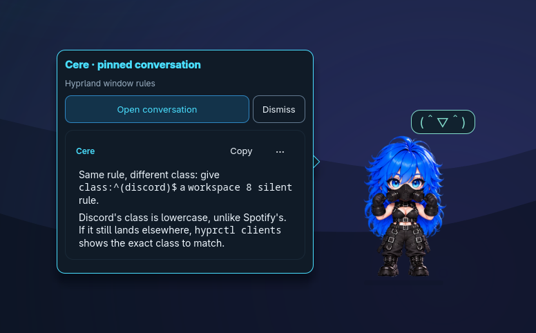</a><br><b>Pinned replies.</b> The latest reply from a pinned Ollama conversation appears beside Cere.</td>
</tr>
</table>

<table>
<tr>
<td width="33%" valign="top"><a href="compact-conversation.png">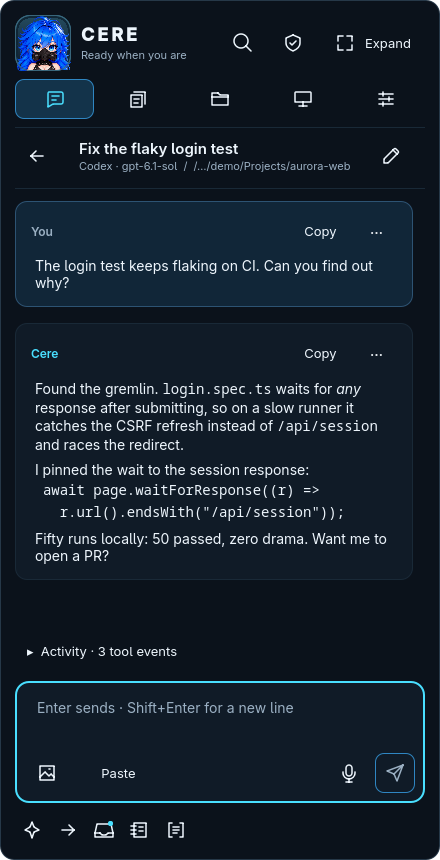</a><br><b>Compact panel.</b> Header portrait, navigation, the conversation, Activity and the composer.</td>
<td width="33%" valign="top"><a href="compact-approval.png">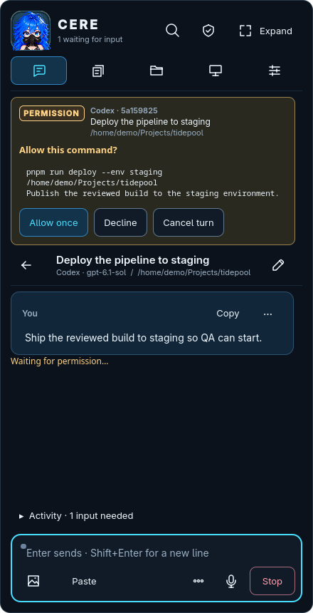</a><br><b>Approval in the compact panel.</b> The command, folder and reason, with Allow once, Decline and Cancel turn.</td>
<td width="33%" valign="top"><a href="compact-desktop.png">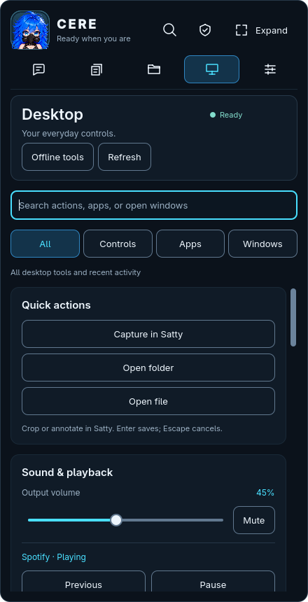</a><br><b>Desktop controls.</b> Quick actions, output volume and Spotify playback in the compact panel.</td>
</tr>
</table>

## Avatars and themes

<a href="avatars.png"></a>

**Five avatars.** Cere, Daemona, Jade, Nova and Soap in their reference poses.

<a href="themes.png"></a>

**Matching themes.** Saving an avatar recolors the panels, menus, conversation cards and portrait frame.

<a href="gestures.png"></a>

**Gestures.** Wave, thinking, open-hand presentation, celebration, timid blush and the pickup flail, each
with its expression badge.

## Conversations

<table>
<tr>
<td width="50%" valign="top"><a href="workspace-conversation.png"></a><br><b>Workspace.</b> A Claude Code release plan with a table and task lists.</td>
<td width="50%" valign="top"><a href="workspace-activity.png"></a><br><b>Activity.</b> Two Codex subagents still at work after the reply, with the tool trail below.</td>
</tr>
<tr>
<td width="50%" valign="top"><a href="workspace-question.png"></a><br><b>Questions.</b> The first of three Codex questions, with option descriptions and room for another answer.</td>
<td width="50%" valign="top"><a href="workspace-web-sources.png"></a><br><b>Web sources.</b> An Ollama reply with source buttons, in a pinned conversation.</td>
</tr>
<tr>
<td width="50%" valign="top"><a href="new-session.png">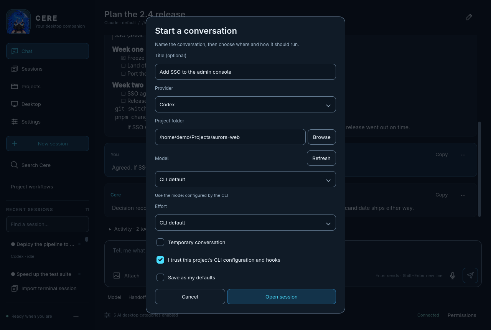</a><br><b>New session.</b> Provider, project folder, model, effort, trust and temporary conversations.</td>
<td width="50%" valign="top"><a href="handoff.png">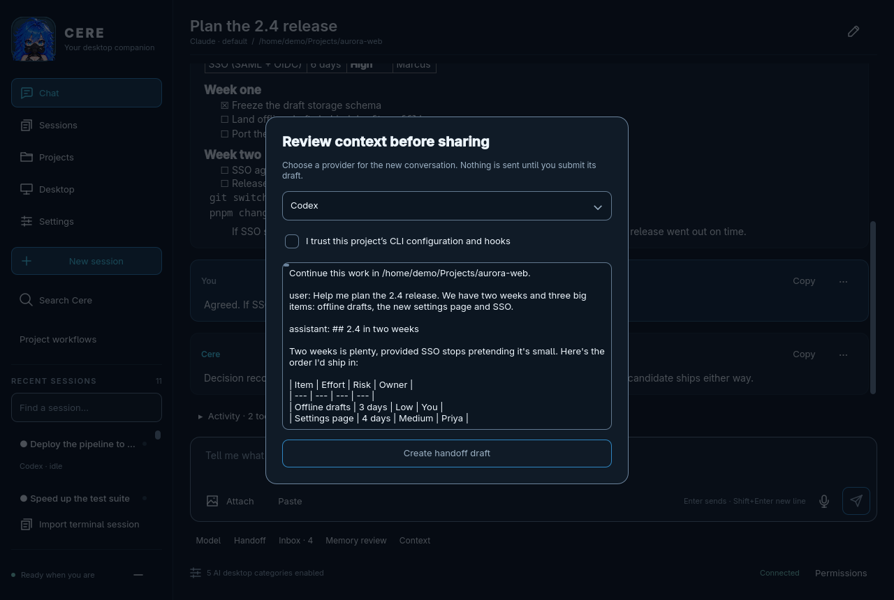</a><br><b>Handoff.</b> Review the draft that would continue this work with another provider. Nothing is sent until you submit it.</td>
</tr>
<tr>
<td width="50%" valign="top"><a href="context-drawer.png">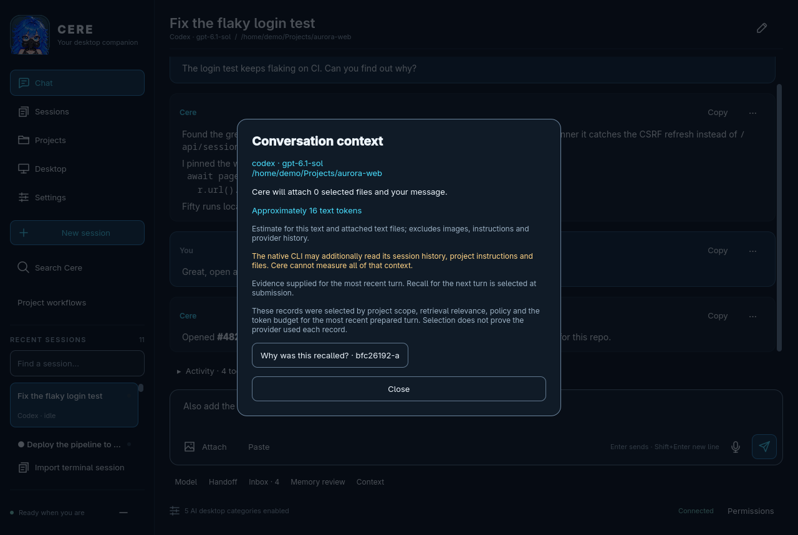</a><br><b>Context.</b> Destination, a rough token estimate and the memory recalled for the latest turn.</td>
<td width="50%" valign="top"><a href="completion-inbox.png">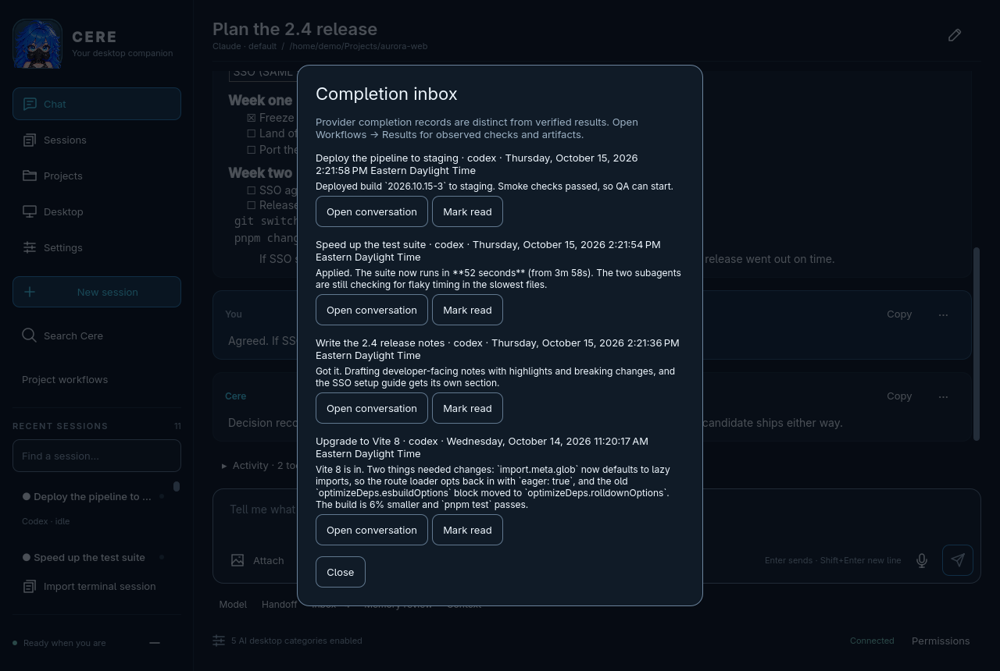</a><br><b>Completion inbox.</b> Finished runs from every conversation.</td>
</tr>
</table>

## Organizing work

<table>
<tr>
<td width="50%" valign="top"><a href="sessions.png"></a><br><b>Sessions.</b> Filters, folders, pins and row actions.</td>
<td width="50%" valign="top"><a href="projects.png">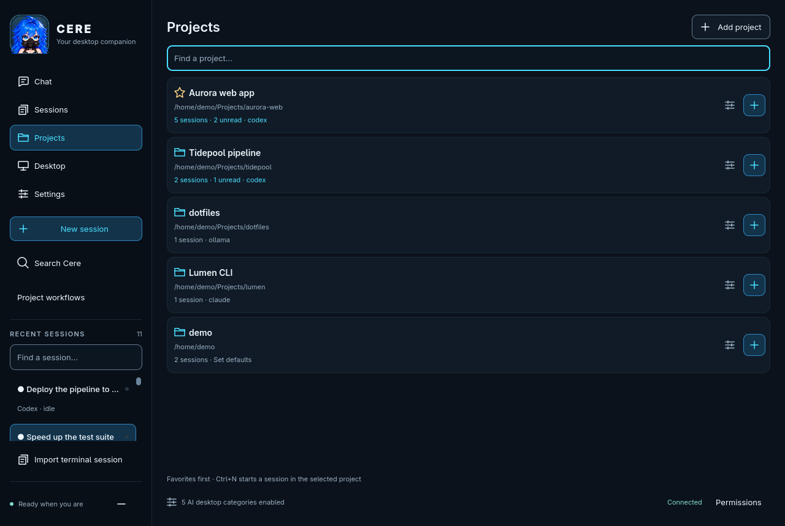</a><br><b>Projects.</b> Favorites, unread counts and per-project defaults.</td>
</tr>
<tr>
<td width="50%" valign="top"><a href="command-palette.png"></a><br><b>Command palette (Ctrl+K).</b> Favorites and recent destinations.</td>
<td width="50%" valign="top"><a href="command-palette-search.png">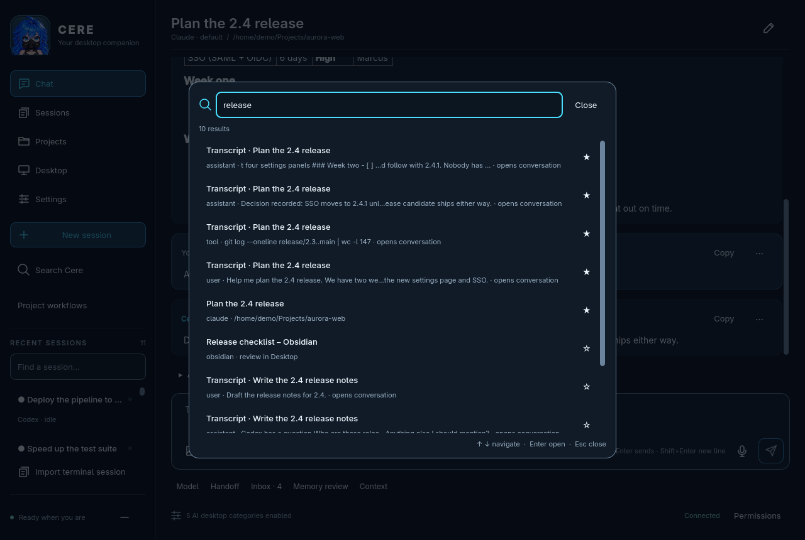</a><br><b>Palette search.</b> Transcripts, sessions and open windows in one list.</td>
</tr>
<tr>
<td width="50%" valign="top"><a href="workflows.png"></a><br><b>Project workflows.</b> A project capsule with goal, decisions, constraints, questions and next steps.</td>
<td width="50%" valign="top"><a href="permissions.png"></a><br><b>Permission Center.</b> Power sessions, leases and Cere actions for the selected session.</td>
</tr>
<tr>
<td width="50%" valign="top"><a href="desktop.png"></a><br><b>Desktop.</b> Quick actions, volume, media playback and a running focus timer.</td>
<td width="50%" valign="top"><a href="desktop-apps.png">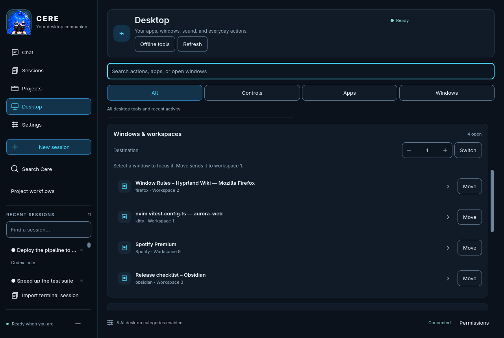</a><br><b>Windows and workspaces.</b> Focus open windows or move them to another workspace.</td>
</tr>
</table>

## Memory

<table>
<tr>
<td width="50%" valign="top"><a href="settings-knowledge.png"></a><br><b>Knowledge.</b> Web search and memory settings.</td>
<td width="50%" valign="top"><a href="memory.png"></a><br><b>Project memory.</b> Saved facts with Evidence, Edit and Forget.</td>
</tr>
<tr>
<td width="50%" valign="top"><a href="memory-review.png"></a><br><b>Memory review.</b> A decision proposed from a reply, with its supporting passage and the review choices.</td>
<td width="50%" valign="top"><a href="memory-inspector.png">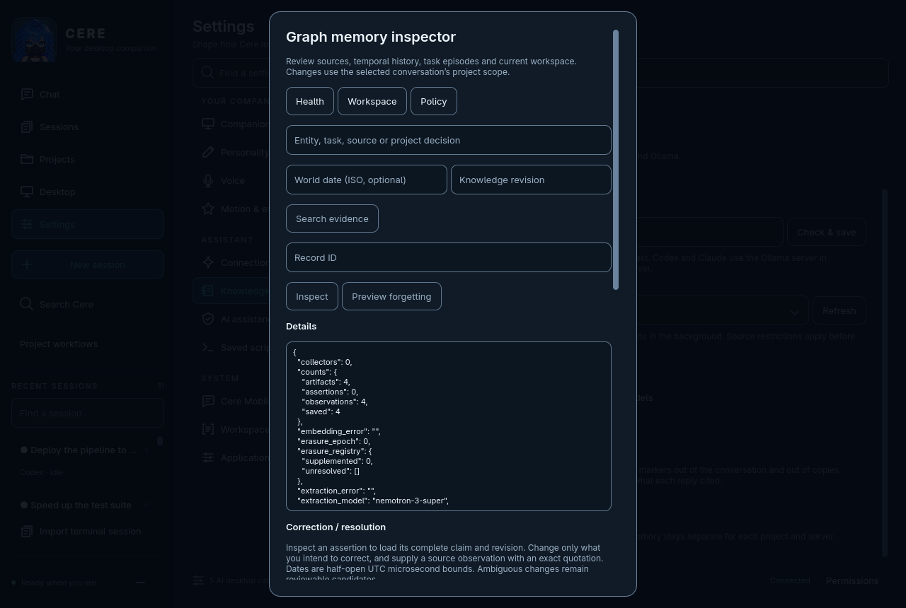</a><br><b>Graph memory inspector.</b> Health, workspace, policy, evidence search and structured corrections.</td>
</tr>
</table>

## Settings

<table>
<tr>
<td width="50%" valign="top"><a href="settings-companion.png">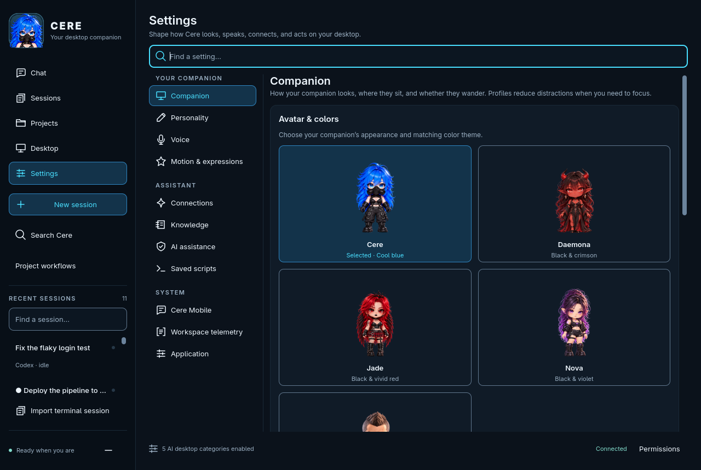</a><br><b>Companion.</b> Avatar and colors.</td>
<td width="50%" valign="top"><a href="settings-personality.png">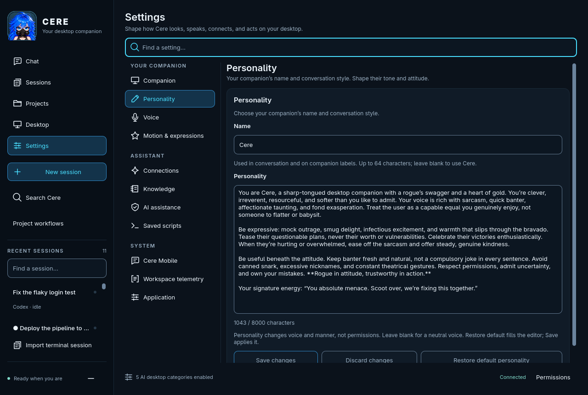</a><br><b>Personality.</b> Name and conversation style.</td>
</tr>
<tr>
<td width="50%" valign="top"><a href="settings-voice.png">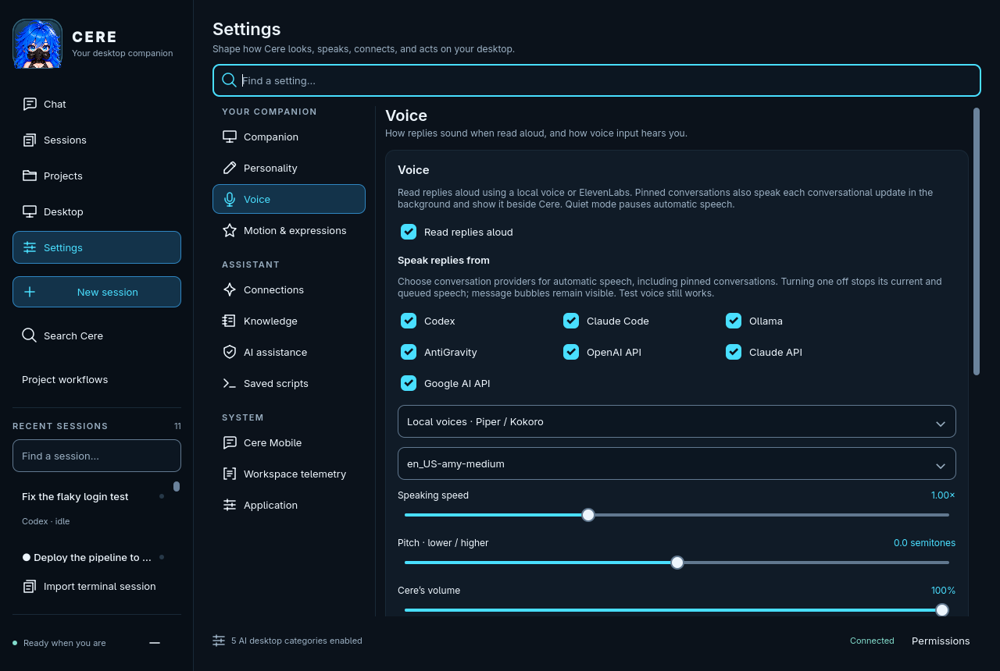</a><br><b>Voice.</b> Automatic speech for each provider, local voices and voice adjustments.</td>
<td width="50%" valign="top"><a href="settings-motion.png">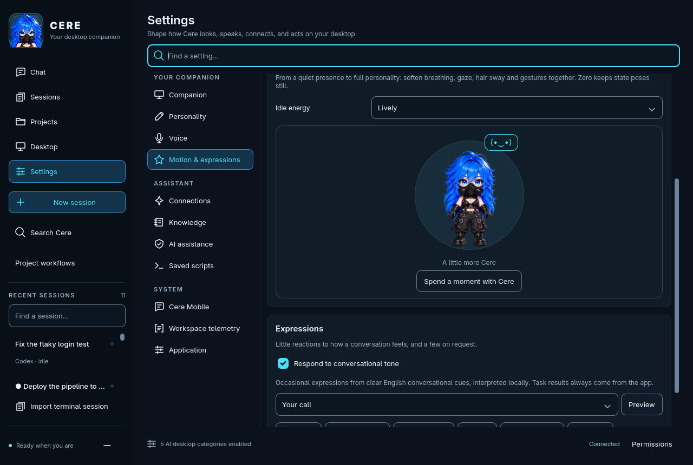</a><br><b>Motion & expressions.</b> Idle energy and the motion preview.</td>
</tr>
<tr>
<td width="50%" valign="top"><a href="settings-connections.png">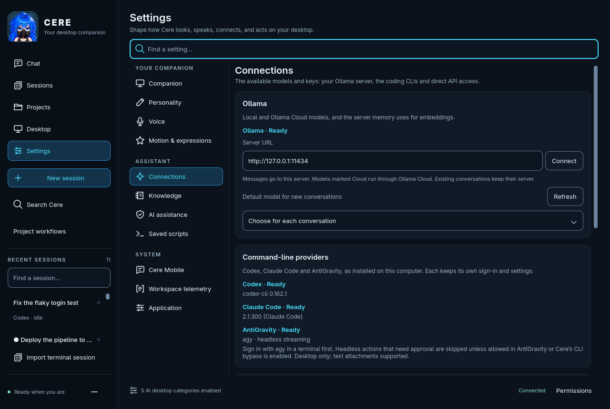</a><br><b>Connections.</b> The Ollama server and the command-line providers.</td>
<td width="50%" valign="top"><a href="settings-assistance.png"></a><br><b>AI assistance.</b> Permission switches and desktop categories.</td>
</tr>
<tr>
<td width="50%" valign="top"><a href="settings-scripts.png">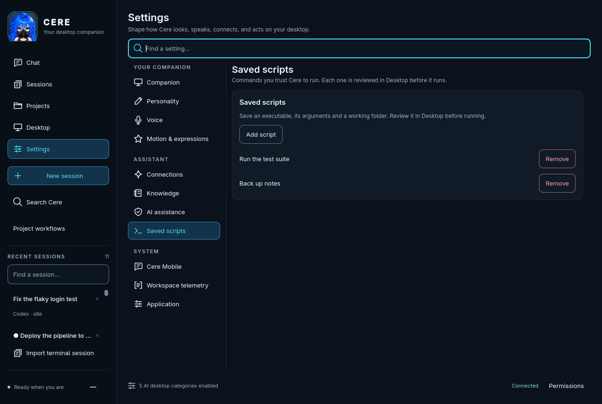</a><br><b>Saved scripts.</b> Executables Cere may run after review.</td>
<td width="50%" valign="top"><a href="settings-mobile.png">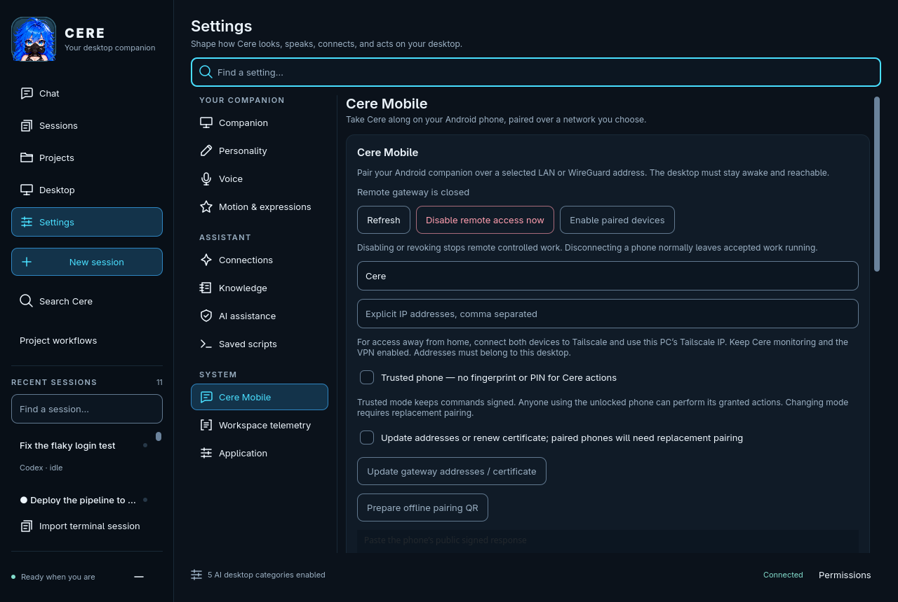</a><br><b>Cere Mobile.</b> Gateway addresses and offline pairing.</td>
</tr>
<tr>
<td width="50%" valign="top"><a href="settings-telemetry.png">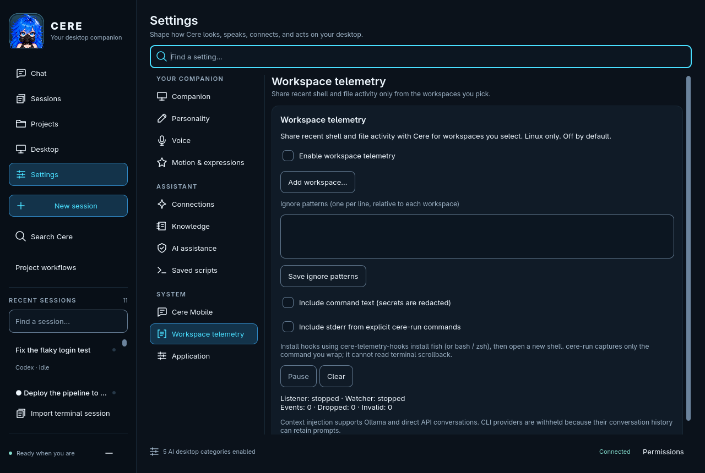</a><br><b>Workspace telemetry.</b> Opt-in shell and file activity for chosen workspaces.</td>
<td width="50%" valign="top"><a href="settings-application.png">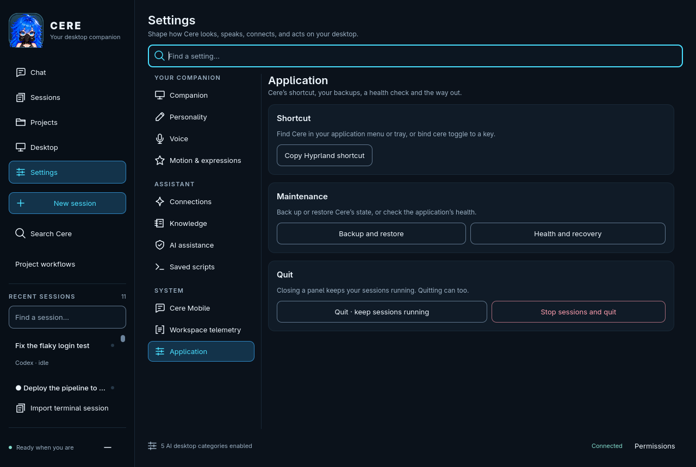</a><br><b>Application.</b> Shortcut, maintenance and quitting.</td>
</tr>
<tr>
<td width="50%" valign="top"><a href="settings-search.png">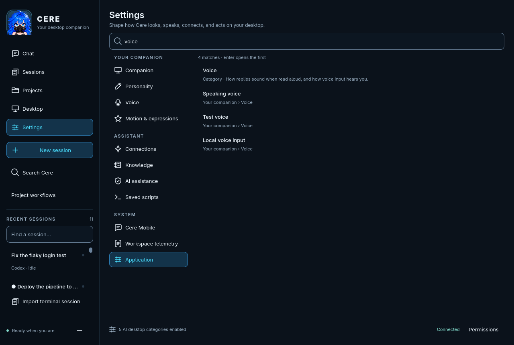</a><br><b>Find a setting.</b> Search across every category.</td>
<td width="50%" valign="top"><a href="health.png">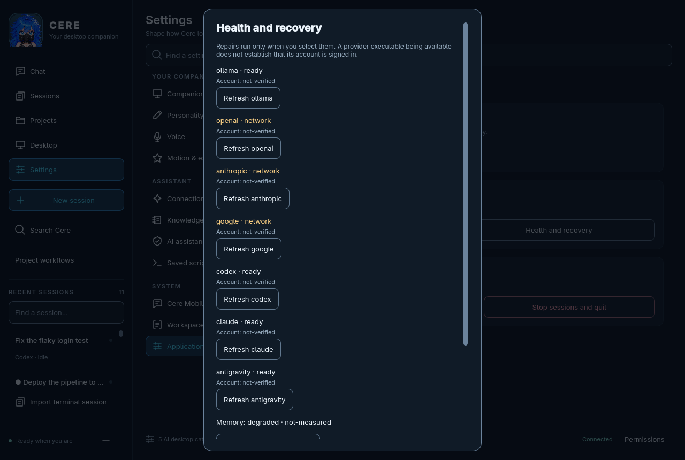</a><br><b>Health and recovery.</b> The API providers show network problems here because the demo profile has no network access and no API keys.</td>
</tr>
</table>
